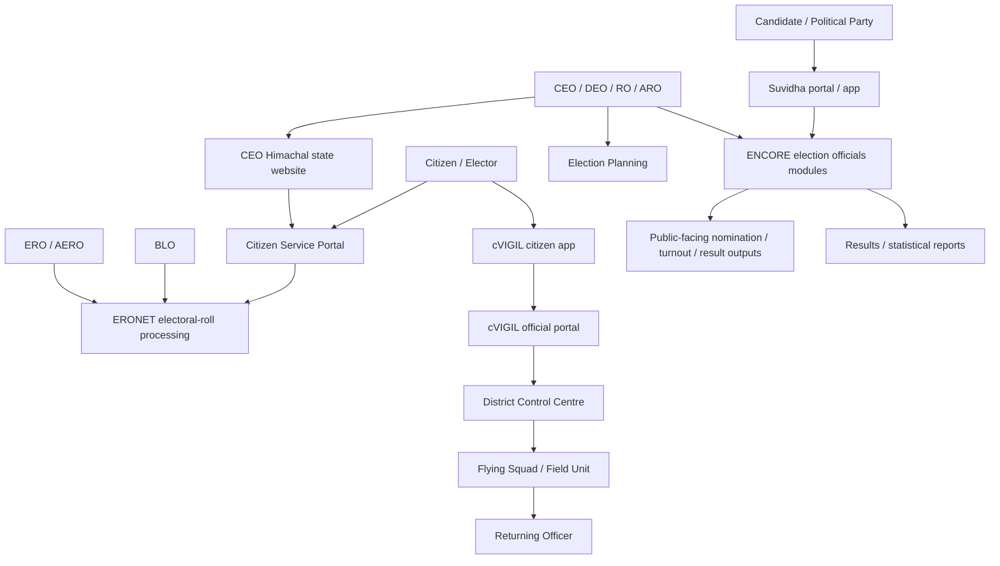

# ECI digital ecosystem map

## Portal and product map

| System | Public entry point | Main audience / purpose | Evidence and access status |
|---|---|---|---|
| ECI public website | `https://www.eci.gov.in/` | Public information, elections, publications, voter/candidate/official navigation | [HTML — supplied] plus [ECI — published] |
| ECINET | `https://ecinet.eci.gov.in/` | ECI-described unified digital platform connecting citizens, candidates/parties, and election officials | [ECI — published]; authenticated modules not inspected |
| Domain provided as `ecinet.gov.in` | `https://ecinet.gov.in/` | User-requested hostname | Direct retrieval in this environment returned HTTP 502; do not assume it is the canonical host |
| Citizen Service Portal | `https://voters.eci.gov.in/` | Registration forms, status, complaints, e-EPIC, voter search, roll downloads, BLO call request | Supplied HTML plus indexed official content |
| CEO Himachal | `https://ceohimachal.hp.gov.in/` | State-specific voter and election information, electoral statistics, BLO/DEO resources | Public indexed content / sitemap |
| ENCORE | `https://encore.eci.gov.in/` | Election officials’ election-process modules including nomination scrutiny, permissions, counting and reporting | Official ECI descriptions; UI not inspected |
| Suvidha | `https://suvidha.eci.gov.in/` | Candidate / party nomination and campaign permission workflows | Official ECI descriptions; UI not inspected |
| cVIGIL citizen app | ECI cVIGIL app page and mobile app stores | Citizens submit evidence of Model Code of Conduct / expenditure violations | Official ECI descriptions |
| cVIGIL official portal | `https://cvigil.eci.gov.in/` | CEO/DEO/RO and control-room handling of citizen complaints | Official ECI descriptions; UI not inspected |
| ERONET / officials | `https://officials.eci.gov.in/` | Electoral-roll processing and field verification workflows | Official ECI descriptions |
| Electoral Search | `https://electoralsearch.eci.gov.in/` | Search elector record / polling information | Publicly linked from ECI and voters portal |
| Results | `https://results.eci.gov.in/` | Current and historical election results | Publicly linked from ECI and voters portal |
| Election planning | `https://eplan.eci.gov.in/` | State/UT and ECI planning, vacancy and schedule monitoring | Official ECI description |
| Observer Portal | `https://observers.eci.gov.in/` | Observer profile, deployment details, reports, messages | Official ECI description |
| ETPBMS | `https://etpbms.eci.gov.in/` | Electronically transmitted postal ballots for service electors | Official ECI description |

## How the systems relate

**Diagram note:** the high-level integrations shown are drawn from official feature descriptions; they are not a network architecture diagram and do not imply a specific API topology.

## ECINET positioning

ECI’s ICT Applications page describes ECINET as a comprehensive digital platform to connect citizens, candidates/political parties and election officials. Its listed services include voter registration, application tracking, voter-card complaints, electoral-roll search, e-EPIC, connecting with election officials, Divyang/Saksham services, BLO call booking, candidate information, MCC complaints, past/current elections, polling trends, and Suvidha 2.0. [ECI ICT Applications](https://www.eci.gov.in/ict-app)

The ECI homepage snapshot includes a footer link to `/ict-app` and an external link to `https://ecinet.eci.gov.in/`. Therefore, this bundle distinguishes the ECINET product from the ECI public website itself.

## Architecture implication for ECIWeb

[Inferred / proposal] Treat ECIWeb as a role-aware workflow platform with shared identity, notification, document, audit, and reporting services. Separate modules (voter services, BLO verification, ERO processing, election operations, candidate permissions, grievances, cVIGIL-style incident handling) should share a consistent case/status model but have distinct permissions and audit trails.
