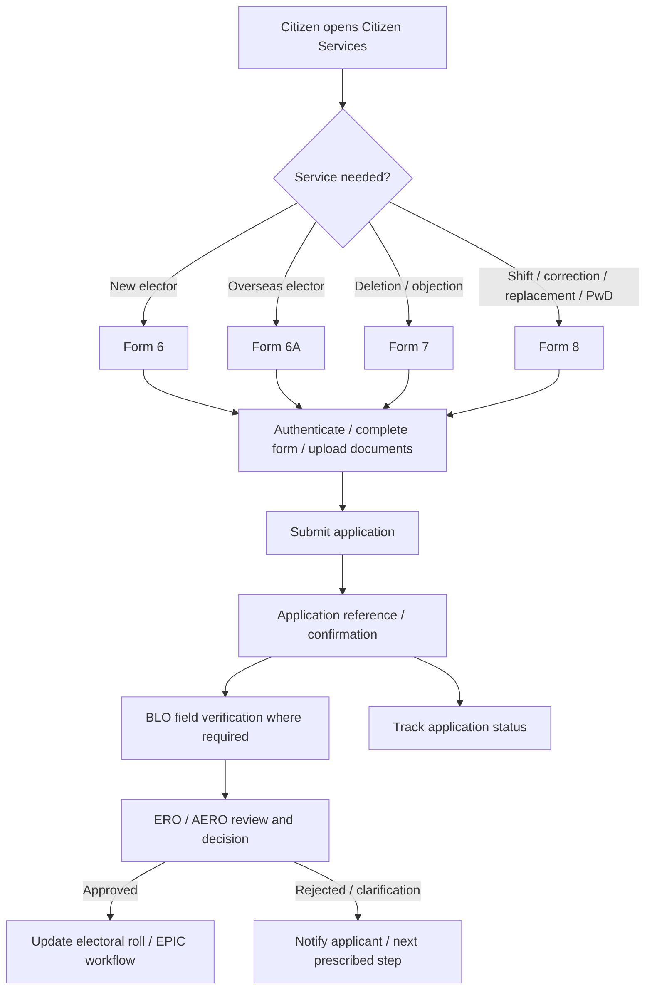
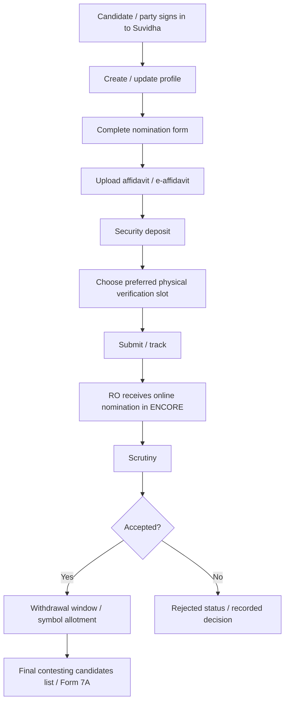
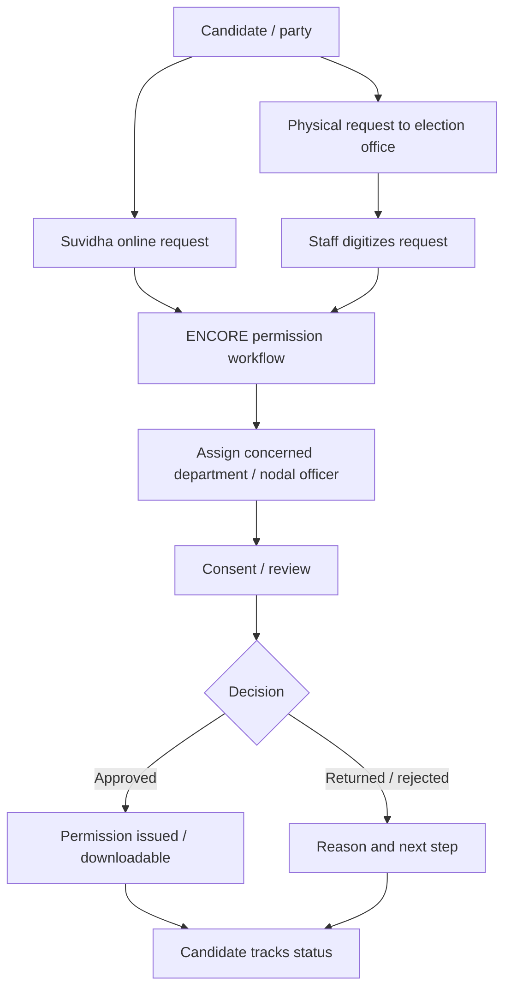
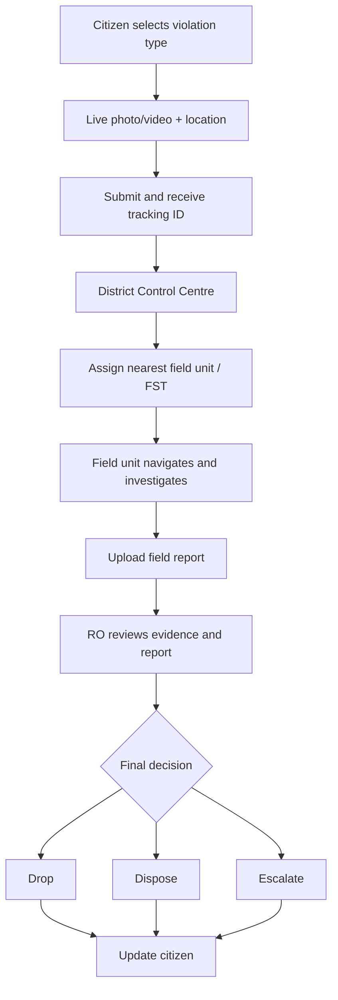
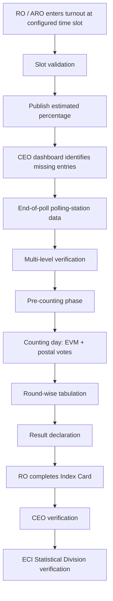

# Workflow blueprints for ECIWeb

These diagrams combine **published ECI workflow descriptions** with **proposed ECIWeb engineering flows**. They are not a legal process manual.

## 1. Voter registration / correction

**Evidence:** Forms 6/6A/7/8 and ERONET registration → field verification → ERO processing are published by ECI. The exact number/order of screens, identity checks and status codes are **not** captured.

## 2. Candidate nomination

**Evidence:** ECI says online nomination starts with Suvidha and includes profile, affidavit, security deposit, slot preference and multiple nominations; ENCORE scrutiny marks accepted/rejected, handles withdrawals, symbols and Form 7A.

## 3. Campaign permission request

## 4. cVIGIL complaint handling

## 5. Poll-day turnout and results

## Shared design rules for ECIWeb

- Every case / application must have a stable ID and immutable audit events.
- A user must be able to see the current status and next responsible actor without seeing restricted internal notes.
- Every transition must be guarded by role, jurisdiction, election context, deadline and data validation.
- Uploads must be virus-scanned, access-controlled, checksummed, and retained under an explicit retention policy.
- Time-based workflows need timezone-safe timestamps, deadline calculators, overdue alerts and escalation logs.
- Avoid a single generic `status` field for every workflow. Use module-specific state machines with common audit-event infrastructure.
