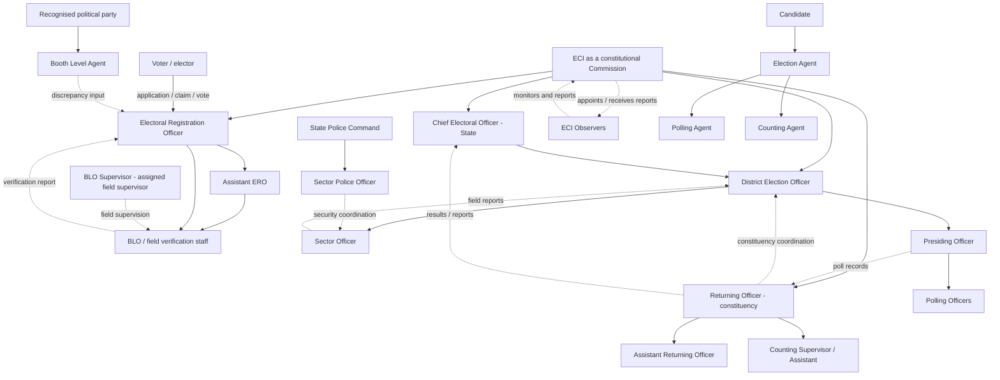
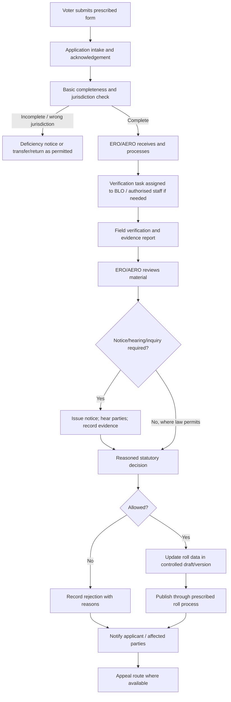
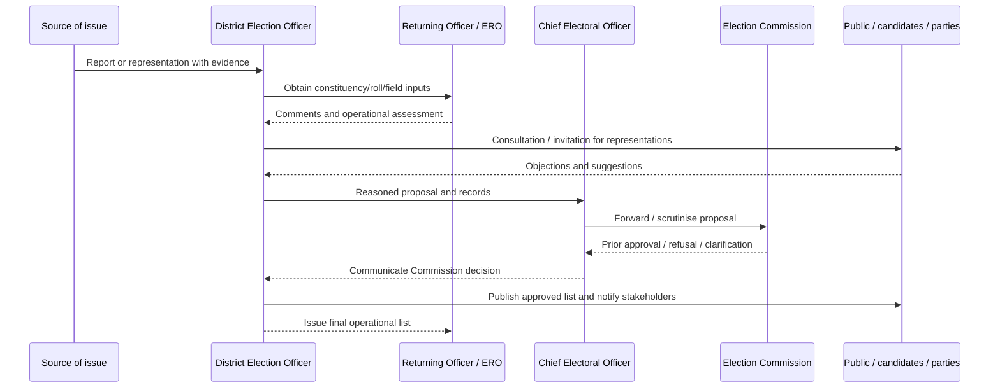
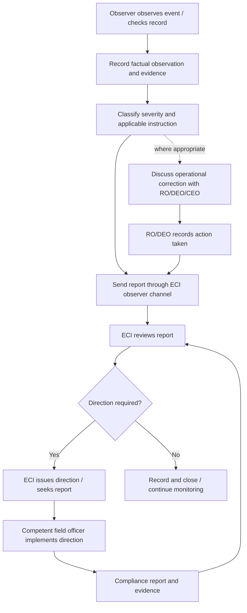

# How Elections Work in India: Authority, Appointments, Data Flows, Polling Stations, Approvals and Change Requests

> **A technical and administrative reference for an India-focused election-management platform**  
> **Prepared:** 4 November 2026  
> **Primary scope:** Elections to the Lok Sabha and State Legislative Assemblies conducted under the Election Commission of India (ECI).  
> **Related but separate scope:** Elections to Panchayats and Municipalities, which are generally conducted by the relevant State Election Commission (SEC), not by the ECI.

---

## 1. Purpose and how to read this document

This document explains how information and decisions move between voters, political participants, electoral-roll officials, election-conduct officials, polling and counting staff, district and state administrations, the Election Commission of India, and independent observers.

It is written for two audiences:

1. **People trying to understand the election-administration system:** who is responsible for what, who appoints whom, who can approve a decision, and where an appeal or escalation goes.
2. **Developers building an election-management platform:** what should be represented as an entity, which role should be allowed to submit or approve a request, which workflows need separation of duties, and which operations must never be exposed as ordinary CRUD actions.

The central design principle is:

> **A person having a login or an administrative title does not, by itself, give that person legal power to make every election decision. Authority comes from the Constitution, an Act or Rule, an ECI order, a valid appointment, and the scope of the function assigned to that person.**

A platform must therefore distinguish between:

- an **office** (for example, District Election Officer);
- a **person** who currently holds that office;
- an **election-specific appointment** (for example, Returning Officer for a particular constituency and election);
- a **delegated function** (for example, an ARO authorised to perform specified RO functions);
- a **system account and permission set** (for example, an account that can prepare a draft but cannot approve it);
- a **legal decision or order** (for example, an ERO order on an application or ECI approval of a polling-station proposal).

These are related, but they are not interchangeable.

### 1.1 Important scope limitation

India has different legal and administrative arrangements for different elections. This document primarily follows the ECI framework for parliamentary and state-assembly elections. Panchayat and municipal elections are generally handled by State Election Commissions under Articles 243K and 243ZA and state legislation. Local-body election roles, appointment orders, forms, deadlines and appeals must be configured from the relevant State Election Commission's rules. Do not automatically reuse the ECI's CEO–DEO–RO chain for local-body elections.

The exact operational arrangements can also differ by state, election, constituency and current ECI direction. The legal provisions cited here establish the baseline; the current appointment orders, ECI instructions, state circulars and election-specific orders must be checked before implementing a live workflow.

---

## 2. The constitutional and legal foundation

### 2.1 Article 324: the Election Commission's constitutional role

Article 324 of the Constitution vests the **superintendence, direction and control** of the preparation of electoral rolls and the conduct of elections to Parliament, State Legislatures, and the offices of President and Vice-President in the Election Commission of India.

The Commission is not merely a software administrator or a department that collects reports. It is the constitutional election authority for the elections covered by Article 324. Its authority is exercised through the Commission as an institution and through officers and staff operating under applicable law and valid directions.

Article 324 also provides for:

- a Chief Election Commissioner (CEC) and other Election Commissioners, subject to the constitutional and statutory appointment framework;
- the President or a Governor making available staff to the ECI when requested for the discharge of election functions.

**Important:** Article 324 is not permission to ignore Acts and Rules. The Supreme Court has explained that the Commission can issue directions in areas where legislation does not occupy the field, but it cannot use Article 324 to contradict an existing statutory provision or rule. A system workflow must follow the Act and Rules first, then applicable ECI directions for matters left to administrative regulation.

### 2.2 Articles 327, 328 and 329

- **Article 327:** Parliament may make laws concerning elections to Parliament and State Legislatures, subject to the Constitution.
- **Article 328:** A State Legislature may make laws concerning elections to its legislature to the extent that Parliament has not made provision on the subject, subject to the Constitution and parliamentary law.
- **Article 329(b):** An election to Parliament or a State Legislature is not ordinarily challenged through a routine administrative appeal. It is challenged by an election petition in the manner provided by law.

This has a practical consequence for software: an officer's administrative screen should not contain a generic “change declared winner” or “overturn election result” action. A result challenge follows the statutory election-petition route, not an ordinary ticket raised to a district administrator.

### 2.3 Panchayat and municipal elections are a different chain

- **Article 243K:** vests superintendence, direction and control of Panchayat elections in the State Election Commission; the State Election Commissioner is appointed by the Governor.
- **Article 243ZA:** applies the State Election Commission framework to Municipal elections, subject to the constitutional provisions and state law.

Therefore, if the application later supports Panchayat or Municipal elections, use a separate election-authority configuration. The ECI's CEC, CEO, DEO and RO accounts should not automatically become authorities for a municipal election.

### 2.4 Principal statutes and rules

The core legal sources for the ECI election workflow are:

| Instrument | Main subject | Typical platform areas affected |
|---|---|---|
| Constitution of India | Constitutional authority and division of legislative power | ECI/SEC authority, law-making, election disputes |
| Representation of the People Act, 1950 (RPA 1950) | Electoral rolls and the officers who supervise them | CEO, DEO, ERO, AERO, roll applications, appeals |
| Registration of Electors Rules, 1960 | Detailed claims, objections, hearings and roll procedure | Form processing, notice, public display, inquiry, publication |
| Representation of the People Act, 1951 (RPA 1951) | Conduct of elections, election officers, polling stations, polling staff, agents, observers and related powers | RO/ARO, DEO, polling staff, agents, observers, polling/counting |
| Conduct of Elections Rules, 1961 | Operational rules for nominations, poll, counting and other election procedures | Candidate filings, polling agents, counting, result forms, recount |
| ECI instructions, manuals and election-specific orders | Operational detail and current implementation directions | Checklists, timelines, standard forms, randomisation, reporting |
| State laws and State Election Commission rules | Local-body elections and state-specific matters | Panchayat/municipal elections |

A manual is important operational guidance, but it is not a substitute for the statute. A handbook may be updated by later ECI instructions. Always store the version/date of the instruction used for an election.

---

## 3. The high-level structure: several connected chains, not one simple hierarchy

A common mistake is to draw all roles in one vertical tree, as though every person reports to the person above them for every purpose. That is not how election administration works.

There are several distinct but connected chains:

1. **Constitutional election authority:** ECI → state-level CEO → district-level DEO, with statutory officers such as ERO and RO appointed for specific responsibilities.
2. **Electoral-roll administration:** ERO → AERO and field staff/BLOs, with DEO and CEO supervisory coordination.
3. **Election conduct:** ECI → CEO → DEO → RO/ARO and other election-conduct staff.
4. **Polling operations:** DEO-appointed Presiding Officers and Polling Officers, coordinated through RO/sector arrangements; Presiding Officer runs the individual polling station on poll day.
5. **Counting operations:** RO supervises counting and appoints counting supervisors/assistants under the applicable rules and instructions.
6. **Police and security administration:** State police command chain, coordinated with election authorities; designated police personnel performing election duties are subject to the statutory ECI-deputation provision during the relevant period.
7. **Independent oversight:** ECI-nominated observers report to the ECI. They monitor and report; they are not simply another layer of district administration.
8. **Political participation:** candidates and their appointed agents act on behalf of candidates/parties within statutory limits. They do not report to BLOs, ROs or DEOs as employees.

### 3.1 Conceptual relationship map

The following diagram is deliberately simplified. Solid arrows indicate an administrative/supervisory or appointment relationship that commonly exists in the stated function. Dotted relationships indicate coordination, reporting, monitoring or independent participation rather than ordinary command. The appointment order and current ECI/state instructions determine the exact relationship in a particular election.



The map should not be interpreted as saying that the CEO personally appoints every district officer, or that a BLO can decide an application because a supervisor is above them. The statutory provisions below define the actual authority.

---

## 4. Who appoints whom? Appointment and designation powers

This section answers the practical question: **which authority selects, designates, appoints or assigns each role?** The words “appoint”, “designate”, “nominate”, “deploy” and “assign” are not always legally interchangeable. The distinction matters in your database and approval engine.

### 4.1 Appointment authority matrix

| Role in your login list | Who appoints/designates/assigns it? | Legal/administrative basis and limits | What the platform should record |
|---|---|---|---|
| Chief Election Commissioner (CEC) | President of India, under the CEC and Other Election Commissioners Act, 2023 process | Selection Committee recommendation under the 2023 Act; term and service conditions are statutory | Presidential appointment instrument, term, office, effective dates |
| Election Commissioner | President of India under the same statutory process | Same institutional framework; do not assume each Commissioner has a separate independent district command | Presidential appointment instrument, term, Commission membership |
| ECI administrator | Not a constitutional or statutory election office by that name; created by the application's own governance | This is a platform-system role, not a power-bearing election post | System-admin grant, scope, reason, approval, expiry; no legal decision powers merely due to this role |
| Chief Electoral Officer (CEO) | ECI, in consultation with the State Government | RPA 1950, Section 13A; supervises electoral-roll preparation/revision/correction in the State, subject to ECI; RPA 1951, Section 20 gives state-level election-conduct supervision | ECI designation order, state, functions, dates, reporting authority |
| District Election Officer (DEO) | ECI, in consultation with the State Government | RPA 1950, Section 13AA; RPA 1951, Section 20A. Usually a senior government officer; can be more than one DEO for a district where required | ECI designation/order, district, election, delegated powers, dates |
| Deputy DEO | Commonly assigned/designated by the State/CEO/DEO administration under state arrangements; not a universal independent statutory post in the two RP Acts | Its powers depend on the order and the underlying office held. It cannot automatically exercise every DEO power | Assignment order, exact delegated functions, limits, dates; link to substantive office |
| Electoral Registration Officer (ERO) | ECI, in consultation with the State Government | RPA 1950, Section 13B; responsible for preparation/revision of the electoral roll for the relevant constituency/area | ECI appointment/designation order, roll area, election/roll revision, dates |
| Assistant Electoral Registration Officer (AERO) | ECI | RPA 1950, Section 13C; works under ERO control and may perform all or specified ERO functions | Appointment order, scope of functions, ERO supervisor, dates |
| Booth Level Officer (BLO) | ERO appoints/designates field-level BLOs under Section 13B(2), following the applicable ECI instructions/administrative approval process; ECI manual describes DEO approval in the appointment workflow | Field verification and voter assistance role. A BLO does not acquire ERO's adjudicatory power | Appointment order, polling-part/area assignment, employer, training, valid dates, supervisor |
| BLO Supervisor | Assigned under ECI/state field-administration arrangements, generally through the roll/DEO/ERO administrative chain | A supervisory designation, not a separately named adjudicating authority in the RP Acts. Must not decide claims/deletions solely because of this title | Assignment order, BLOs covered, geographic scope, permitted review/check functions |
| Returning Officer (RO) | ECI, in consultation with the State Government | RPA 1951, Section 21; designated for a constituency. An officer may be RO for more than one constituency where lawfully arranged | ECI designation, constituency, election, appointment dates, statutory functions |
| Assistant Returning Officer (ARO) | ECI | RPA 1951, Section 22; assists RO and may perform RO functions subject to statutory restrictions and RO control; scrutiny of nominations has special limits | Appointment order, constituency, RO, permitted functions, limitations |
| Sector Officer | Normally appointed/assigned by DEO from suitable government officials under ECI operational instructions | Sector officer is an operational designation in ECI manuals, not a separately named statutory office in the RP Acts. Field coordination, route/area familiarisation, polling-party support and reporting | DEO order, sector ID, polling stations covered, reporting chain, dates |
| Sector Police Officer | Assigned through the State/district police administration in coordination with election arrangements | A police deployment/coordination designation; exact authority depends on state police orders. Not a statutory RO/DEO subordinate simply by being in the same sector | Police deployment order, sector, police reporting chain, election coordination assignment |
| Presiding Officer | DEO appoints for each polling station under RPA 1951, Section 26 | Runs the polling station and maintains order/procedure under the Act and Rules | DEO appointment, polling-station ID, poll date, training, replacement history |
| Polling Officer | DEO appoints under RPA 1951, Section 26 | Assists Presiding Officer. Presiding Officer may make a temporary replacement in specified circumstances where a Polling Officer is absent, with required intimation | DEO appointment, assigned station, duty, replacement record |
| Counting Supervisor | RO appoints under the Conduct of Elections Rules and ECI instructions | Works under RO's counting arrangements; must satisfy impartiality/eligibility conditions | RO order, counting centre/table, randomisation batch, role and dates |
| Counting Assistant | RO appoints under the Conduct of Elections Rules and ECI instructions | Assists counting supervisor/RO; does not independently declare result | RO order, counting centre/table, randomisation batch, role and dates |
| General Observer | ECI nominates under RPA 1951, Section 20B | Monitors election conduct and reports to ECI; special statutory powers apply in limited situations | ECI nomination, constituency/area, assignment, report channel, dates |
| Police Observer | ECI deploys/nominates an eligible senior police officer under observer arrangements | Monitors police/security arrangements and reports; does not become the district police command authority | ECI deployment/nomination, assigned area, reporting line, dates |
| Expenditure Observer | ECI nominates/deploys an observer under its observer arrangements | Monitors election expenditure and related compliance; makes reports/recommendations, not final criminal or disqualification adjudications | ECI order, constituency/area, expenditure remit, dates |
| Counting Observer | ECI nominates an observer for counting oversight under the applicable observer instructions | Monitors counting arrangements and reports; the RO remains responsible for statutory counting and declaration functions, subject to ECI directions | ECI order, counting centre/constituency, scope, reports |
| Micro Observer | ECI deploys/assigns micro-observers for identified critical polling stations or counting arrangements | Observer/monitoring function, generally reporting to the designated observer; does not replace Presiding Officer or Counting Supervisor | ECI/DEO assignment, station/table, training, reporting observer, dates |
| District Nodal Officer | Assigned by DEO/CEO/State Government/ECI arrangement depending on subject | Functional designation (e.g., EVM, expenditure, SVEEP, media, accessibility, postal ballot, law and order); not a universal statutory office | Nodal subject, appointment/assignment order, parent department, scope, dates |
| State Nodal Officer | Assigned by CEO/State Government/ECI, depending on the subject | State-level coordination designation; no blanket legal power over all districts or statutory decisions | Subject, appointing authority, scope, district links, dates |
| State Police Nodal | Assigned by State police/Home Department, commonly with ECI coordination for election duties | Police coordination and reporting designation; remains subject to police law and election-duty directions that apply to designated personnel | State police order, jurisdiction, remit, dates |
| District Police Officer | Designated by State police structure (e.g., district SP/Commissionerate equivalent); exact title varies by state | Police administration and law/order; not automatically DEO's subordinate. Must coordinate with election administration and obey applicable election-duty control | Police posting order, district, rank, command relationships, election assignment |
| Candidate | Nominated by a political party or files nomination as an independent, then nomination accepted under law | Candidate status is determined through nomination/scrutiny and valid election process | Nomination papers, scrutiny result, symbol/order, constituency, status |
| Election Agent | Candidate appoints an election agent under RPA 1951, Section 40, subject to prescribed procedure | Represents the candidate for authorised election functions; does not become an election official | Candidate authorisation, acceptance/notice, constituency, validity period |
| Polling Agent | Candidate or election agent appoints under Section 46 and the Conduct of Elections Rules | Represents candidate at the specified polling station under prescribed conditions | Appointment notice, candidate, polling station, identity/acceptance, replacement history |
| Counting Agent | Candidate or election agent appoints under Section 47 | Represents candidate at counting, subject to entry and conduct rules | Appointment notice, counting centre/table where assigned, identity, validity |
| Booth Level Agent (BLA) | Recognised political party appoints through its authorised party representative under ECI instructions | Party-side roll-checking and discrepancy input. BLA is not a BLO and cannot decide enrolment/deletion | Party authorisation, polling part/area, appointment date, validity, access scope |
| Voter/elector | Not appointed | A person becomes an elector through the statutory roll process; eligibility and entry are decided under the law | Application/roll entry, verification, decision/order, roll version, appeal history |

### 4.2 The CEC and Election Commissioners: appointment process

Under the Chief Election Commissioner and Other Election Commissioners (Appointment, Conditions of Service and Term of Office) Act, 2023:

1. A Search Committee headed by the Union Minister for Law and Justice prepares a panel of five eligible persons for consideration.
2. The Selection Committee consists of the Prime Minister (Chairperson), the Leader of Opposition in the Lok Sabha (or the leader of the largest opposition party where the statutory condition applies), and a Union Cabinet Minister nominated by the Prime Minister.
3. The President appoints the CEC and other Election Commissioners by warrant, based on the Selection Committee's recommendation.
4. The Act provides a six-year term or tenure until age 65, whichever is earlier, subject to the Act's provisions; reappointment is not permitted under the Act.

For system design, the Commission should be represented as an institution with membership and internal allocation of business. Do not create a rule that any one Election Commissioner can independently perform every ECI action merely because they hold that title. The legal and administrative authority for a particular order must be checked against the Commission's applicable allocation/delegation and the relevant statute.

### 4.3 CEO, DEO, ERO and RO are not a single appointment ladder

These offices have different statutory purposes:

- **CEO:** state-level supervision of roll preparation/revision and election conduct.
- **DEO:** district-level coordination/supervision of electoral-roll work and conduct of elections; also has particular statutory responsibilities, including polling-station provision under Section 25 of RPA 1951.
- **ERO:** adjudicatory responsibility for the relevant electoral roll.
- **RO:** constituency-level responsibility for conduct of a particular election, including nominations, poll and counting functions under RPA 1951.

The same government officer may hold more than one designation in a particular place or time, but the system must store each designation and its legal scope separately. Do not infer that appointment as DEO automatically makes the person ERO or RO.

---

## 5. What each group does and what information moves through it

### 5.1 Voter / elector

A voter interacts with the election system in at least four distinct ways:

1. **Registration and roll maintenance:** applies for inclusion, correction, deletion/objection, shifting or other legally recognised roll service through the applicable form and channel.
2. **Roll verification:** checks whether their details are correct and whether they appear in the correct polling part/area.
3. **Election participation:** votes at the assigned polling station, subject to electoral-roll status and polling rules.
4. **Complaint or assistance:** submits a complaint, seeks help, reports an access problem or raises a service request.

The voter is the source of an application or claim, not the officer who decides it. A voter cannot edit the official electoral roll directly. A platform may let a voter update a draft application, but the official record changes only after the competent ERO/AERO decision and the applicable roll-publication process.

### 5.2 Candidate

A candidate:

- files nomination papers through the prescribed process;
- supplies required affidavits and declarations;
- may appoint an election agent;
- may appoint polling agents and counting agents under the Act and Rules;
- may submit representations or complaints through authorised channels;
- may request a recount in the prescribed manner and time;
- may challenge an election through an election petition if the statutory grounds and requirements are met.

A candidate does not appoint RO, ARO, Presiding Officer, Polling Officer, ERO or BLO. Candidate agents observe or represent the candidate within statutory limits; they do not command election staff.

### 5.3 Election agent

The election agent is the candidate's principal authorised representative for election work covered by the appointment. The agent may perform functions permitted by law and may appoint polling/counting agents where the Act permits. The agent can submit candidate-side representations and receive election-related notices as allowed by the rules.

The agent does not have government authority. In the platform, the election-agent dashboard should show candidate-related submissions and notices, not internal government records or voter personal data beyond what the law makes available.

### 5.4 Polling agent

A polling agent is appointed for a polling station by the candidate or election agent. The agent is permitted to observe the poll and undertake the activities allowed by the Conduct of Elections Rules and ECI instructions. The polling agent does not control the queue, verify the legal eligibility of another elector, direct Polling Officers, or alter the polling register.

### 5.5 Counting agent

A counting agent represents a candidate during counting. They can observe and raise objections/requests as permitted by the rules. The counting agent does not count independently, handle election material outside authorised procedure, or declare the result.

### 5.6 Booth Level Agent (BLA)

A BLA is appointed by a recognised political party under ECI instructions to assist the party in checking electoral-roll entries for a polling part. The BLA may bring possible errors, omissions, duplicate entries or other discrepancies to the notice of the competent election-roll officials through the prescribed process.

A BLA is **not**:

- a government BLO;
- an ERO/AERO;
- a voter-registration adjudicator;
- a polling agent appointed by a candidate for poll day;
- authorised to add, delete or correct a voter record directly.

The system should keep the BLA and BLO identities, permissions, affiliations and workflows entirely separate. Party affiliation must be explicit and auditable.

### 5.7 BLO and BLO Supervisor

A BLO is a field-level election-roll functionary. Typical responsibilities include:

- visiting the relevant polling-part area;
- assisting citizens with the prescribed forms and application process;
- checking factual particulars such as residence and other information relevant under the current rules;
- identifying apparent deceased, shifted or duplicate entries for lawful follow-up;
- reporting field findings to the ERO/AERO;
- supporting public roll verification and roll-revision activities;
- communicating deficiencies to applicants where instructed.

The BLO's field report is evidence/input. It is not the final statutory order. A BLO should not be allowed to click “delete elector” and directly remove a name from the official roll.

A BLO Supervisor may allocate visits, check field progress, review completeness and coordinate a set of BLOs. Unless a specific lawful delegation says otherwise, the supervisor is not the adjudicating authority for claims and objections. A system can allow a supervisor to return an incomplete field report for further verification, but the final acceptance/rejection should be made by the ERO or properly empowered AERO.

### 5.8 ERO and AERO

The ERO is the competent statutory roll authority for the relevant roll. The ERO's responsibilities include:

- preparation and revision of electoral rolls;
- receiving and deciding claims and objections under the applicable law;
- ordering or considering inquiry/verification where required;
- ensuring notices and hearing processes are followed;
- correcting erroneous entries and deciding inclusions/deletions in accordance with the Act and Rules;
- supervising AEROs and the roll machinery;
- ensuring the roll is properly prepared and published.

An AERO acts under the ERO's control and can perform functions authorised under Section 13C and the relevant order. The application must store the particular AERO delegation. “AERO” should not automatically mean unrestricted authority to perform every possible ERO action in every case.

### 5.9 RO and ARO

The RO is the principal statutory officer for conducting an election in a constituency. Typical responsibilities include:

- receiving nomination papers;
- conducting scrutiny and other nomination-stage functions;
- managing candidate/agent notices and election records;
- coordinating polling arrangements with the DEO;
- supervising poll-related actions assigned to the RO;
- supervising counting;
- dealing with recount requests under the rules;
- preparing and signing result documents;
- declaring the result unless the ECI directs otherwise.

An ARO assists the RO and may perform RO functions within Section 22 and the valid appointment/delegation. The scrutiny of nominations has a special statutory restriction: an ARO does not ordinarily perform that function unless the RO is unavoidably prevented from doing so, as provided by law.

### 5.10 Presiding Officer and Polling Officers

At the polling station, the Presiding Officer is responsible for conduct of the poll, maintenance of order and compliance with the prescribed procedure. Polling Officers assist with the steps assigned to them, such as checking the elector against the roll, applying identification/indelible-ink procedures, maintaining registers and operating prescribed equipment/processes.

The exact allocation of tasks depends on the current ECI instructions and the polling-station workflow. The platform must not turn the Presiding Officer into a person who can change the underlying electoral roll. The PO can record that a person presented themselves, that a procedure was completed, that an objection arose, or that a poll event occurred. A separate statutory mechanism governs roll changes and any challenge to a person's entitlement.

### 5.11 Sector Officer and Sector Police Officer

A Sector Officer is an operational field coordinator, usually covering a group of polling stations. ECI guidance commonly assigns sector officers responsibilities such as:

- familiarising themselves with polling-station locations and routes;
- checking facilities and accessibility;
- coordinating polling-party movement and local readiness;
- communicating issues to RO/DEO;
- monitoring assigned polling stations on poll day;
- reporting incidents, turnout or logistical problems as instructed.

A Sector Police Officer works within the police deployment/command arrangement for the sector. The officer coordinates security, route or local law-and-order matters with civil election officers. Do not assume that a Sector Officer commands the Sector Police Officer or that a Sector Police Officer can decide electoral-roll or counting questions.

### 5.12 DEO, Deputy DEO and nodal officers

The DEO coordinates the district's election machinery and has specific statutory functions. The DEO is particularly important for:

- polling-station provision under Section 25 of RPA 1951, subject to prior ECI approval;
- appointment of Presiding Officers and Polling Officers under Section 26;
- district election planning and coordination;
- ensuring adequate staff, venues, transport, materials and facilities;
- coordinating with the CEO, RO, ERO and district administration;
- consolidating district reports and escalating unresolved matters.

A Deputy DEO typically assists in this work. However, “Deputy DEO” should be implemented as an assignment with explicitly delegated functions rather than as a universal statutory role with automatic full DEO authority.

Nodal officers are usually subject-specific coordinators. Examples may include EVM/VVPAT, expenditure monitoring, media certification, MCC, SVEEP, accessibility, postal ballot, training, transport, IT and law-and-order coordination. A nodal officer can coordinate and report within the assigned subject, but the title does not itself authorise the officer to override an ERO, RO, DEO or ECI order.

### 5.13 CEO and State-level nodal officers

The CEO is the ECI's state-level election administration officer under the RP Acts. The CEO supervises roll preparation/revision and election conduct in the State, subject to ECI directions, and coordinates DEOs and other state machinery.

State nodal officers coordinate subject-specific work across districts. Their authority comes from the assignment order and the subject's legal framework. For example, a state nodal officer coordinating expenditure reports is not automatically authorised to decide whether an ERO must include a voter or to approve a polling-station relocation.

### 5.14 Police officers

The District Police Officer, State Police Nodal Officer and Sector Police Officer belong to the police administration structure. Their normal command and service relationship is governed by state police law, service rules and police orders.

Election law adds a special layer: Section 28A of RPA 1951 places specified election officers and police officers designated for election duty on deputation to the ECI for the statutory period, subject to the provision. This does not mean every police officer in the State becomes subordinate to an RO. The platform should store which police personnel have been designated for which election duty and the period of that designation.

### 5.15 Observers

Observers nominated by the ECI provide independent monitoring and reporting. They are often described as the Commission's eyes and ears in the field. The observer's job is to detect, verify, report and recommend corrective action through the ECI's observer channel.

An observer is not the same as a DEO/RO and should not be represented as their routine superior. The observer may interact with the CEO, DEO and RO to understand or facilitate correction of issues, but formal observer reporting is to the ECI. An observer must follow the exact statutory and ECI instructions for the assigned category.

---

## 6. Electoral-roll data flow: from a citizen's application to an official roll entry

The roll workflow is one of the most important data pipelines in the platform. It must preserve the distinction between **application intake**, **field verification**, **statutory adjudication**, **publication**, and **appeal**.

### 6.1 Main data objects

A useful data model includes:

- `Elector`: stable internal identity for the individual, with carefully controlled personal information.
- `ElectoralRollEntry`: the person's official entry in a particular roll version and polling part.
- `RollApplication`: Form 6/7/8 or another currently prescribed application, with submitted fields and applicant declarations.
- `ApplicationDocument`: uploaded document metadata and secure file reference.
- `FieldVerificationTask`: visit/verification task assigned to a BLO or authorised field staff.
- `FieldVerificationReport`: observations, date, method, outcome and supporting evidence.
- `Notice`: notice sent to applicant/objector/affected elector where required.
- `Hearing`: scheduled hearing, attendance, submissions and record of proceedings.
- `EROOrder`: reasoned decision, legal ground, decision-maker and signed order.
- `Appeal`: statutory appeal record, authority, limitation date, decision and further appeal.
- `RollPublication`: published roll draft/final/supplement, version, date, publication proof and scope.
- `PollingPartAssignment`: the polling part/area mapping applicable for that roll version.

Do not overwrite the historical official entry in place. Maintain versioned records and preserve the decision that caused each change.

### 6.2 Typical application lifecycle



The diagram is conceptual. The exact sequence, notice requirements, publication and hearing steps depend on the particular form, rule, statutory ground and current ECI instructions.

### 6.3 Form intake is not approval

For a normal roll application, the applicant may use the prescribed online/offline channel and may receive help from a BLO. The application is then processed by the ERO/AERO machinery.

The system should record at least:

1. Who submitted the application (the applicant, authorised representative or staff-assisted intake).
2. The submission channel and timestamp.
3. The prescribed form and version used.
4. The constituency, part and jurisdiction identified at intake.
5. Whether required declarations and documents were provided.
6. Acknowledgement/reference number.
7. Which ERO/AERO is competent for the record.

The intake service should not have the ability to mark a request “approved” merely because it passed a document-upload check.

### 6.4 Field verification

The ERO/AERO may assign a verification task to a BLO or other authorised person. A task should contain only the data needed to perform the verification. A field report should be structured rather than a free-form “verified = true” flag.

Recommended report fields include:

- task ID and application ID;
- assigned officer and appointment record;
- visit date/time and verification method;
- location/part visited (avoid unnecessary precise location retention);
- whether the applicant/person was contacted;
- factual observations relevant to the form;
- discrepancy categories;
- documents or evidence inspected and their source;
- whether a revisit or additional inquiry is recommended;
- officer's declaration and submission timestamp;
- supervisor review, if required by instructions.

A BLO report should be treated as a factual input. It should not silently create or delete the official roll entry.

### 6.5 ERO/AERO decision

The competent ERO/AERO reviews the application, field report, documents, notice and hearing record as required. The decision should be reasoned and linked to the applicable legal provision and rule.

For every decision, store:

- the deciding officer's appointment and delegated authority;
- the exact roll jurisdiction;
- the application and version decided;
- evidence considered;
- notice/hearing compliance;
- decision (allow, reject, partly allow, return or other legally valid disposition);
- reasons and legal basis;
- signed order or authenticated electronic record;
- decision timestamp and effective date;
- notification details;
- review/appeal information where applicable.

### 6.6 Appeals

Section 24 of RPA 1950 provides an appeal structure for specified orders under Sections 22 and 23. In broad terms, the first appeal is to the prescribed district-level appellate authority (such as the District Magistrate/Additional District Magistrate/Executive Magistrate/District Collector or equivalent officer, as provided by the provision/rules), and a further appeal lies to the CEO as provided by law and rules.

The platform must configure the actual competent appellate authority for the State and current rule. Do not hard-code “all roll appeals go to DEO” or “all appeals go to CEO” without mapping the correct stage and applicable notification.

### 6.7 BLA input into the roll process

A BLA may identify a possible discrepancy and submit a representation through the allowed channel. The issue is then taken up by the ERO/BLO machinery according to the rules.

Correct model:

`BLA observation → ERO/authorised intake → lawful verification/inquiry → ERO/AERO decision → roll version update/publication if allowed.`

Incorrect model:

`BLA clicks “delete” → elector disappears from the roll.`

The application must never allow party agents to directly edit elector records.

---

## 7. Who can add, remove, merge or relocate polling stations?

This is one of the clearest statutory decision boundaries.

### 7.1 The legal answer: DEO provides; ECI gives prior approval

**Section 25 of the Representation of the People Act, 1951** provides that the District Election Officer shall, with the **previous approval of the Election Commission**, provide a sufficient number of polling stations for every constituency whose whole or greater part lies within the district, and publish a list of polling stations showing the polling areas or groups of voters for which each is provided.

Therefore:

- The **DEO is the statutory district-level officer who provides the polling stations**.
- The **ECI's prior approval is required**.
- The DEO cannot unilaterally add, delete or relocate an approved polling station just by editing the platform.
- RO, ARO, ERO, BLO, Sector Officer, party BLA, candidate or local nodal officer does not independently approve a polling-station change under Section 25.
- Political parties and other stakeholders may be consulted and may make representations, but consultation is not the same as approval authority.

This is the rule your application should enforce.

### 7.2 What counts as a polling-station change?

Be precise about terminology:

- A **polling station** is the legally recognised place/station at which electors assigned to it vote.
- A **polling location/building** is the physical premises used. One building may contain more than one polling station.
- A **polling part** is the electoral-roll segment associated with a station.
- A **polling area** is the locality/area or group of electors assigned to a station.
- “Booth” is often used colloquially, but the data model should use the legally and operationally accurate terms.

Changes can include:

1. Creating an additional polling station because the number of electors or local conditions justify it.
2. Splitting electors from one station across two stations.
3. Merging or rationalising stations where lawfully justified.
4. Shifting a station to another building or location.
5. Changing the room within the same complex where the operational/legal identity remains the same, subject to the relevant instructions.
6. Changing a building's name or official nomenclature without actually shifting the station.
7. Revising the polling area or electors assigned to a station.

Do not treat all seven actions as the same database update. They have different operational and approval implications.

### 7.3 Typical grounds for a proposal

ECI manuals/checklists describe grounds such as:

- a significant increase in the number of electors;
- a building becoming unsafe, damaged or unavailable;
- a natural disaster or other exceptional event;
- a site becoming inaccessible or unsuitable;
- the need to improve accessibility, security, facilities or voter convenience;
- a genuine local change that makes the existing arrangement impractical.

A request must state the reason and include supporting facts. “The local officer prefers another building” is not enough.

### 7.4 Standard proposal and approval path

A typical workflow is:

1. **Issue identified:** BLO, Sector Officer, RO, ERO, local administration, party representative or another authorised source identifies a possible problem. A party/candidate may submit a representation.
2. **Evidence collected:** current elector count, distance, access, building condition, ownership/availability, safety, disability access, photographs or inspection report, affected polling part and map.
3. **District scrutiny:** the DEO's election team checks the proposal and coordinates with the relevant RO/ERO and local authorities.
4. **Stakeholder consultation:** recognised political parties and other required stakeholders are consulted as per ECI instructions. Objections and representations are recorded.
5. **Proposal sent upward:** the DEO submits a reasoned proposal through the CEO to the ECI in the prescribed format/channel.
6. **ECI prior approval:** the ECI considers and approves, rejects or seeks clarification. No final change is implemented before approval where Section 25 requires it.
7. **DEO finalises and publishes:** after approval, the DEO issues/publishes the revised polling-station list and associated area mapping in the prescribed manner.
8. **Communication:** CEO/DEO/RO/ERO, candidates, recognised political parties and affected electors are informed according to current directions.
9. **Operational updates:** staff assignments, polling materials, route plans, voter search, signage, accessibility and public-facing information are updated against the approved version.
10. **Audit:** retain the original list, proposal, consultations, ECI approval, final order, publication evidence and effective date.



This is an operational representation of the usual approval chain; the current ECI instructions determine the submission format and precise consultation steps.

### 7.5 Exceptions and building-name changes

ECI instructions distinguish a genuine shift/change in the polling-station location from a mere change in building nomenclature where the physical location has not changed. A name-only correction may be handled differently and may require intimation rather than the same prior approval process. Do not use this exception to disguise a physical relocation or a change to the polling area.

### 7.6 How the platform should enforce Section 25

A polling-station change should be a **controlled change request**, not a direct edit form.

Suggested states:

`DRAFT → DISTRICT_REVIEW → STAKEHOLDER_CONSULTATION → SENT_TO_CEO → SENT_TO_ECI → ECI_APPROVED / ECI_REJECTED / CLARIFICATION_REQUIRED → DEO_FINAL_ORDER → PUBLISHED → OPERATIONALLY_APPLIED`.

Minimum fields:

- election ID and constituency;
- district and polling-station ID;
- type of change (create, shift, split, merge, rename, polling-area revision);
- existing approved state/version;
- proposed state/version;
- legal basis: RPA 1951 Section 25 and applicable instruction;
- reason and supporting evidence;
- number of electors affected;
- proposed polling-area mapping;
- consultation participants, date and responses;
- DEO recommendation and signature;
- CEO forwarding details;
- ECI approval/reference/date;
- DEO final publication order;
- notification/publication proof;
- activation date and superseded version.

**Hard rule:** users must not be able to set `status = APPROVED` from a browser request or by changing a MongoDB field. The backend must verify the authenticated appointment, scope and required approval record. An ECI approval reference should be a required prerequisite for a material Section 25 change.

---

## 8. Appointment and deployment of polling and counting staff

### 8.1 Presiding Officers and Polling Officers

Section 26 of RPA 1951 places appointment of the Presiding Officer and Polling Officers with the DEO for each polling station. The DEO appoints the Presiding Officer and such number of Polling Officers as considered necessary, subject to the Act and current ECI instructions.

The statute also addresses an absence at the station: in specified circumstances the Presiding Officer can appoint a person to act in place of an absent Polling Officer and must inform the DEO as required. This is a contingency power, not a general power to recruit arbitrary staff.

Operational workflow:

1. DEO estimates required staffing based on polling stations and current instructions.
2. Eligible government/other permitted personnel are identified and checked for disqualification/conflict.
3. Staff are randomised/allocated as directed by ECI instructions; sensitive allocation details should be restricted.
4. Appointment orders and duty assignments are generated.
5. Training and attendance are recorded.
6. Dispatch/receipt of polling materials is recorded.
7. On poll day, the PO records station events and staff presence.
8. Absence/replacement is recorded with statutory basis and immediate intimation.
9. After poll, staff submit prescribed documents/materials and the appointment is closed.

The application should not permit a candidate, BLA, polling agent or BLO to appoint a PO or Polling Officer.

### 8.2 Counting Supervisors and Counting Assistants

Counting staff are part of the RO's counting arrangements. Under the Conduct of Elections Rules and ECI instructions, the RO appoints counting supervisors and assistants and organises tables/rounds/teams. The staff must satisfy applicable impartiality and eligibility requirements.

Typical workflow:

1. RO plans counting centre, tables and staff requirement.
2. Eligible personnel are identified and subjected to the prescribed randomisation/deployment process.
3. Appointment and training are recorded.
4. Counting-day attendance and table assignment are confirmed.
5. Counting teams enter round-wise data in the prescribed official documents/system.
6. RO checks and consolidates the result; observers monitor and report.
7. Result documents are signed and issued by the competent RO as prescribed.

Counting staff must not declare the constituency result or change a candidate's vote total outside the prescribed counting and correction procedure.

### 8.3 Polling station assignment and officer assignment must be versioned together

If a polling station is lawfully changed, the system must reconcile:

- PO and Polling Officer assignments;
- polling-party dispatch and transport;
- station kit and EVM/VVPAT allocation records;
- security/sector assignments;
- polling-area mapping;
- candidate/polling-agent station authorisations;
- public station lookup and voter communication;
- accessibility and facility checks.

A station change without corresponding operational updates creates a dangerous mismatch between the legal list and the poll-day system.

---

## 9. Election conduct: the process from notification to result

### 9.1 ECI announces the election schedule

The ECI determines and announces the election programme under the applicable law. The schedule establishes key dates, such as nomination, scrutiny, withdrawal, polling and counting. Once the programme is announced, the administration moves into election-mode operations and the Model Code of Conduct applies according to ECI directions.

For software, store the official schedule as an election object with version, source order, jurisdiction and effective times. Do not let a district user create or alter the official polling date.

### 9.2 Constituency and RO configuration

Each constituency has an RO designated under Section 21 of RPA 1951 and one or more AROs under Section 22. Their appointment orders and jurisdiction should be linked to the election object.

### 9.3 Nomination and scrutiny

The candidate submits nomination documents through the prescribed route. The RO receives nominations, conducts scrutiny and records lawful decisions. An ARO can assist and perform permitted functions under the Act, subject to the special restriction regarding scrutiny.

Data flow:

`Candidate → RO/authorised receiving channel → nomination record → scrutiny proceedings → RO order → candidate list / symbol / notices.`

The platform should preserve every version of a nomination submission and all orders. A document upload being present does not mean the nomination is valid; scrutiny is a legal decision.

### 9.4 Campaign and expenditure monitoring

Candidates and parties carry out campaign activity subject to election law, expenditure limits and ECI instructions. Expenditure monitoring teams and observers collect and examine records, reports, complaints and evidence.

Data flow may include:

- candidate/party expenditure statements;
- accounting registers and vouchers;
- flying squad or surveillance team reports;
- media monitoring and paid-news referrals;
- seizure/complaint records where relevant;
- candidate explanations;
- observer report and ECI/competent authority directions.

A software flag such as “expenditure suspicious” is not itself a final finding of a violation. The case must retain evidence, response, competent authority and final legal disposition.

### 9.5 Poll preparation

DEO, RO, Sector Officers and other assigned officers coordinate:

- polling station readiness and facilities;
- staff appointment and training;
- EVM/VVPAT and election-material logistics under current instructions;
- transport and route arrangements;
- security deployment;
- accessibility and voter assistance;
- communication of polling-station lists and polling-area mappings;
- contingency plans.

The system should use the **approved polling-station list version** as the source of truth. Draft proposals must never be presented to voters as final station assignments.

### 9.6 Poll day

At the station:

1. Polling party reports and establishes the station under the prescribed procedure.
2. Presiding Officer completes required pre-poll formalities and records.
3. Polling Officers perform their assigned voter identification and poll-process duties.
4. Polling agents may be present under the rules.
5. The PO manages order and records incidents, challenges, interruptions and prescribed declarations.
6. Sector Officer and observers monitor/report through their respective channels.
7. At close of poll, the PO prepares and seals prescribed records/materials and hands them over under the prescribed chain of custody.
8. RO/DEO consolidates receipt and relevant poll reports.

The platform should capture operational facts but must not reveal or store how an individual voted. Ballot secrecy is fundamental. No role—admin, observer, polling officer, party agent or candidate—should have a feature to view a named voter's vote choice.

### 9.7 Adjourned poll, fresh poll and booth capturing

The law provides special procedures for serious disruptions:

- **Section 57:** where a poll is adjourned for a reason such as riot, open violence, natural calamity or other sufficient cause, the Presiding Officer takes the prescribed action and reports it. The RO reports onward; resumption arrangements follow the statutory and ECI approval process.
- **Section 58:** covers fresh poll in specified circumstances, including destruction/loss/tampering or other statutory grounds.
- **Section 58A:** deals with booth capturing and empowers the ECI, on the required report/material, to order fresh poll or take the statutory action, including countermanding the election in appropriate circumstances.

A generic `incident_resolved=true` checkbox cannot close these events. Use a case workflow with the source officer, evidence, RO report, observer inputs, ECI order, affected station/constituency, fresh-poll schedule and publication/notification.

### 9.8 Counting and result

The RO is responsible for counting under Section 64 of RPA 1951 and the Conduct of Elections Rules. Candidates, election agents and counting agents may be present as permitted. Observers monitor and report.

Typical counting workflow:

1. RO issues counting arrangements and notices.
2. Counting staff are appointed and assigned.
3. Counting centre access is controlled and recorded.
4. Counting proceeds according to the applicable procedure, round and table records.
5. Discrepancies/objections are recorded and resolved by the competent officer under the rules.
6. A candidate/election agent/counting agent may request a recount in writing under Rule 63 within the prescribed stage/time. The RO makes a decision with reasons under the rule.
7. RO completes and signs the prescribed result documents.
8. RO declares the result under Section 66, unless an ECI direction or statutory circumstance prevents it.
9. Official result is transmitted/published through authorised channels.

The system should not calculate and publish a legally final result solely from unapproved table-level input. It should distinguish provisional round data, reconciled counting data, signed official result and public display.

### 9.9 Election petitions

An election result challenge is generally made by an election petition under Part VI of RPA 1951, in the competent High Court, subject to statutory grounds, procedure and limitation. Article 329(b) bars treating the challenge as an ordinary pre-result or post-result administrative appeal.

A platform may record a petition reference or court order if authorised, but should not let a system administrator reverse a declared result. A court's judgment or competent legal order must be separately recorded and implemented through the correct legal mechanism.

---

## 10. Observers: oversight, reporting and limited special powers

### 10.1 General Observer

The ECI may nominate an Observer under Section 20B of RPA 1951. The observer monitors the election and performs functions entrusted by the Commission. Typical work includes reviewing election preparedness, nominations, campaign, poll arrangements, poll-day complaints, post-poll events and counting, according to the assignment.

The observer reports to the ECI. The observer can interact with RO/DEO/CEO to inspect records and facilitate corrective action, but should not be represented as a universal command superior to all district staff.

Section 20B gives an observer a specific power in limited serious situations during counting: where the statutory conditions relating to large-scale booth capturing or missing/destroyed/tampered election material make the result incapable of being ascertained, the observer may direct the RO not to declare the result or to stop counting as provided, and must report to the ECI. The ECI then issues the appropriate direction. This is not a general power to cancel any result because the observer disagrees with the count.

### 10.2 Police Observer

The Police Observer monitors police/security arrangements, sensitive areas, deployment, law-and-order readiness and election-related security concerns. The observer reports to the ECI through the specified channel and coordinates with the police and civil administration. The observer is not a replacement for the state police chain of command or a magistrate.

### 10.3 Expenditure Observer

The Expenditure Observer monitors expenditure-related compliance, the functioning of monitoring teams and reported expenditure discrepancies. The observer may seek records, inspect monitoring arrangements, report suspected violations and recommend action. Final consequences—such as statutory disqualification, criminal prosecution or a formal election-law determination—must be handled by the authority competent under the applicable law.

### 10.4 Counting Observer

A Counting Observer monitors whether the counting process follows ECI instructions and reports issues to the ECI. The RO remains the statutory counting authority. The observer should not edit counting tables or independently declare a result.

### 10.5 Micro Observer

Micro-observers may be deployed at identified critical polling stations or other designated locations. They observe the process and report to the designated observer/ECI channel under instructions. They are not additional Presiding Officers and do not take over the station's statutory responsibilities.

### 10.6 Observer reporting workflow



The platform should support confidential observer reporting. Do not make every observer report visible to political participants or every district user by default. Access must follow the ECI's reporting protocol.

---

## 11. Police and civil administration: how the two chains interact

Election administration depends on police and civil authorities, but their ordinary service chains are not identical.

### 11.1 Normal police command

A typical state police arrangement may include State Police Headquarters/Director General of Police, ranges/zones, district SP or Commissionerate leadership, subdivisions, police stations and field officers. Titles and structures differ by State.

The District Police Officer and State Police Nodal Officer are not created as statutory ERO/RO roles by the RP Acts. They are police administration/designation roles.

### 11.2 Election-duty designation

Section 28A of RPA 1951 provides that the RO, ARO, Presiding Officer, Polling Officers and other officers appointed under the relevant part, along with police officers designated by the State Government for the time being for election duty, are deemed to be on deputation to the ECI for the statutory period and subject to ECI control, superintendence and discipline as specified.

The platform must keep two relationships:

- **service/department relationship:** the person's normal police or government department chain;
- **election-duty relationship:** the designated election assignment and its legal start/end period.

Do not model the DEO as the normal employer or permanent disciplinary authority of every police officer. Do not model the police SP as the authority that can alter the electoral roll or polling-station list.

### 11.3 Security information flow

A reasonable operational flow is:

`Sector Police Officer / local police → district police control / designated nodal officer → DEO/RO coordination channel → CEO/ECI where required.`

Observers have a separate reporting path to the ECI. The exact real-time channel and confidentiality must follow ECI/state instructions and security protocols.

Typical data includes:

- sensitive polling-station assessment;
- route and force deployment plan;
- law-and-order incident report;
- threat/complaint information;
- security incident response;
- polling material escort information;
- post-poll strong-room security status.

Security-sensitive information should be access-controlled and should not be shown to candidates, party agents or the public unless officially released.

---

## 12. Bills, Acts, Rules, ECI instructions and administrative change requests

The phrase “change request” can mean several very different things. A request to correct one elector's address is not a request to amend an Act. A DEO's request to shift a polling station is not a Bill. The platform should classify requests before routing them.

### 12.1 Four levels of change

| Level | What is being changed? | Typical authority/path | Example |
|---|---|---|---|
| 1. Individual case decision | One person's record or one election case | Competent statutory officer under the Act/Rules, with notice/inquiry/appeal as applicable | ERO decides a Form 6 application |
| 2. Local operational arrangement | Staff duty, venue logistics, sector assignment, district readiness | Officer with the relevant statutory/delegated power; often DEO/RO or police chain; ECI approval where statute/instruction requires | Reassign a polling-party vehicle; propose station relocation |
| 3. ECI administrative instruction/direction | Standard operating procedure or implementation detail within the Commission's legal authority | ECI issues direction/order; CEO/DEO implement and report | Updated poll-day reporting format or additional operational instruction |
| 4. Law or rule amendment | The legal framework itself | Parliament/state legislature for Acts; Central Government/competent rule-making authority for rules, following statutory consultation and laying/publication requirements; Constitution amendment under Article 368 where required | Amend RPA 1951 or Conduct of Elections Rules |

A fifth category is a **court order or judgment**, which must be handled as a judicial direction and not as an administrative preference.

### 12.2 How an ordinary administrative change request should pass

A useful generic workflow is:

1. **Initiation:** authorised officer or stakeholder raises a request.
2. **Classification:** system determines the request class—roll, polling station, staff, security, schedule, counting, expenditure, system configuration or legal-policy request.
3. **Jurisdiction check:** verify election, district, constituency, polling station and competent authority.
4. **Legal-basis check:** select relevant Act/Rule/ECI order; require a reason if no specific legal provision applies.
5. **Evidence:** attach reports, maps, document references, inspection photos, stakeholder submissions or relevant data.
6. **Conflict and impact analysis:** identify voters, polling stations, staff, candidate notices, public information, downstream systems and election deadlines affected.
7. **Recommendation:** immediate supervisor or subject nodal officer may review/recommend, but must not become the final authority unless lawfully empowered.
8. **Competent approval:** route to the authority who has legal power. Where prior ECI approval is required, the process must stop before activation until that approval is recorded.
9. **Reasoned order:** store the decision, legal basis, conditions, signatory, timestamp and reference.
10. **Publication/notification:** notify affected officials, candidates/parties/electors or public as required.
11. **Implementation:** update the operational data only after the approval gates have been satisfied.
12. **Audit and closure:** preserve before/after snapshots, proof of notification, implementation report and supersession history.

### 12.3 Example: request to add a polling station

- **Who may raise it?** A DEO/RO/ERO/Sector Officer may identify the operational need; a party, candidate, elected representative, voter group or local authority may make a representation through the allowed channel.
- **Who investigates?** District election machinery, including relevant RO/ERO/field officers, under DEO coordination.
- **Who recommends?** DEO submits the reasoned proposal through the CEO channel.
- **Who gives required prior approval?** ECI under Section 25.
- **Who finalises/provides and publishes the district list?** DEO, after the required approval.
- **Who updates voter-facing assignment and operational staff?** The authorised district/constituency machinery after the final approved list is published.

### 12.4 Example: request to correct a voter record

- Voter submits the prescribed form or objection.
- BLO may verify facts and send a report.
- BLA may point out a discrepancy but cannot decide it.
- ERO/AERO processes and decides under the RPA 1950 and Registration of Electors Rules.
- Appeal follows Section 24 and applicable rules.
- The roll is updated in the appropriate version/publication cycle.

### 12.5 Example: request to change polling staff

- A DEO or authorised election official identifies the need.
- The competent appointment authority (for POs/Polling Officers, DEO under Section 26) approves a replacement or reassignment, subject to current ECI instructions.
- If staff have already been dispatched, movement, material custody, training and station records must be updated.
- A party agent or candidate cannot order the replacement. They may raise a complaint through an authorised channel.

### 12.6 Example: request to stop or reschedule poll

A local officer can report an incident and take immediate steps permitted by law. But the final statutory route depends on the type of event:

- adjournment under Section 57;
- fresh poll under Section 58;
- booth-capturing action under Section 58A;
- ECI directions and statutory reporting.

Do not route every request to “DEO approves”. The competent authority varies by statutory ground and stage.

### 12.7 Example: request to change a counting total/result

A counting discrepancy must be handled during counting under the rules and through the RO's prescribed records. A recount request is made in writing under Rule 63 at the prescribed stage; the RO decides it with reasons. After declaration, a challenge generally proceeds by election petition under RPA 1951 and Article 329(b), not a system-admin edit.

---

## 13. How a Bill becomes an Act, and how election rules are amended

### 13.1 Ordinary parliamentary Bill

An ordinary Bill generally proceeds through the following stages:

1. **Introduction / First Reading:** a Bill is introduced in either House of Parliament by a Minister (Government Bill) or a non-minister Member of Parliament (Private Member's Bill), subject to the applicable procedure.
2. **Second Reading:** the House considers the general principles. The Bill may be referred to a committee, circulated for comments or taken up for clause-by-clause consideration under the applicable parliamentary procedure.
3. **Committee and clause consideration:** the committee may examine the Bill and report recommendations. The House considers clauses and amendments.
4. **Third Reading:** the House votes on the Bill as a whole.
5. **Other House:** the Bill must be passed by the other House in the same form, subject to the constitutional process for resolving disagreement on an ordinary Bill.
6. **President's assent:** after passage by both Houses, the Bill is presented to the President. Upon assent, it becomes an Act, subject to commencement provisions.
7. **Commencement and implementation:** the Act may commence immediately, on a specified date, or on a date appointed by notification, depending on its text.

For a Bill that changes the RPA 1950 or RPA 1951, the law-making process is parliamentary. The ECI may be consulted, give recommendations or provide implementation feedback, but the Commission does not itself pass an Act.

### 13.2 Constitutional amendment under Article 368

A Constitution Amendment Bill must satisfy the special majority prescribed by Article 368 in each House: a majority of the total membership of that House and at least two-thirds of members present and voting. Where the amendment affects provisions covered by the federal ratification proviso, ratification by at least half of the State Legislatures is also required before presentation for Presidential assent.

Changes to the constitutional framework for the ECI or State Election Commissions may therefore require a constitutional amendment process, depending on the provision being changed. A normal ECI circular cannot amend Article 324, 243K or 243ZA.

### 13.3 Rules under RPA 1950 and RPA 1951

The Acts delegate rule-making powers to the competent government authority, with ECI consultation where the relevant section requires it.

- **RPA 1950, Section 28:** Central Government may make rules, after consulting the ECI, for matters relating to electoral rolls.
- **RPA 1951, Section 169:** Central Government may make rules, after consulting the ECI, for carrying out the purposes of the Act. The section contains the parliamentary laying mechanism for rules and the possibility of modification/annulment by Parliament as provided in the statute.

A rule amendment is not the same thing as an ECI manual update. The system should store the Gazette notification, rule number, amendment text, commencement date and any transitional provisions.

### 13.4 ECI directions and manuals

Within the constitutional and statutory framework, the ECI issues instructions, handbooks, circulars, directions and election-specific orders. They may:

- explain the implementation of an Act or Rule;
- prescribe operational formats and reporting channels;
- assign responsibilities to officers;
- set practical deadlines and workflows;
- address situations not exhaustively covered by legislation, provided the direction does not contradict the law.

A manual is often a practical guide and may be amended or supplemented by later instructions. For a live election, the platform must keep a register of current instructions and the exact circular applicable to each workflow.

### 13.5 State-level laws and local-body changes

A State Legislature may legislate on elections to its State Legislature only to the extent permitted by Article 328 and the constitutional framework; Parliament's laws take precedence where they occupy the field. For Panchayat and municipal elections, relevant constitutional provisions and state laws govern the State Election Commission's powers and procedures.

Do not route a local-body election rule change to the ECI CEO simply because your system already has a CEO account.

---

## 14. Delimitation: who changes constituency boundaries?

Changing a polling station is not the same as changing the boundary of an Assembly or Parliamentary constituency.

Constituency delimitation is governed by constitutional provisions and parliamentary law, including the relevant Delimitation Act and the Delimitation Commission process. It is not a normal DEO/CEO configuration task. A DEO cannot redraw an Assembly constituency boundary by editing polling-part assignments.

A platform should distinguish at least:

- parliamentary constituency;
- Assembly constituency;
- district and sub-district boundaries;
- polling station and polling part;
- polling area;
- delimitation order/version and effective date.

When a new delimitation order becomes legally effective, the platform should ingest the official order and perform a controlled migration of the affected constituency, polling-part and roll mappings. Preserve the previous boundary version for historical election records.

---

## 15. Information flows: who sends what to whom?

This section turns the institutional model into data routes. The exact reporting format and frequency should follow the active ECI instructions for the election.

### 15.1 Roll information flow

| Sender | Information sent | Recipient | Recipient action |
|---|---|---|---|
| Voter/applicant | Roll application, declarations, supporting documents, correction request | ERO/AERO intake channel | Register, check jurisdiction and process |
| BLO | Field verification report and factual observations | ERO/AERO | Consider as evidence/input; decide under law |
| BLO Supervisor | Work-progress/completeness review and field escalation | ERO/DEO as assigned | Correct allocation or seek further verification |
| BLA | Party-side discrepancy/roll observation | ERO/authorised roll channel | Consider through lawful process; no direct record edit |
| ERO/AERO | Orders, notices, roll progress and prescribed reports | DEO/CEO/affected persons | Supervision, appeal/notification/publication |
| DEO | District roll-revision status and coordination report | CEO | State-level monitoring/escalation |
| CEO | State roll status and issues | ECI | Commission supervision/directions |

### 15.2 Election-conduct information flow

| Sender | Information sent | Recipient | Typical purpose |
|---|---|---|---|
| ECI | Schedule, instructions, appointment/designation orders, directions | CEO, DEOs, ROs, observers and other officers | Establish official election programme and requirements |
| CEO | State instructions, review requests, consolidated reports | DEOs/ECI | State coordination and escalation |
| DEO | District plan, station list, staffing orders, readiness reports | CEO/RO/ECI as required | District execution and statutory reporting |
| RO | Nomination records, constituency plans, poll/count reports, result documents | DEO/CEO/ECI as required | Conduct constituency election |
| Sector Officer | Field readiness and poll-day reports | RO/DEO | Detect and resolve station-level issues |
| Presiding Officer | Prescribed poll records, incidents, declarations and materials | RO/receiving authority | Official poll record and counting preparation |
| Police chain | Security and law-and-order plans/incidents | District/state police command and election coordination channel | Security response |
| Observer | Independent observations and recommendations | ECI | Oversight and directions where required |

### 15.3 Poll-day incident information flow

A serious incident should be represented as a case, not a chat message. Capture:

- incident ID and election ID;
- polling-station/sector/constituency;
- reporter and appointment scope;
- incident type and time;
- factual description;
- immediate action taken and statutory basis;
- police response, if relevant;
- evidence and witness/source metadata;
- RO/DEO acknowledgement;
- observer report/reference, if any;
- ECI direction/order, if required;
- final action and closure evidence.

Do not allow a reporter to erase or edit the original report after escalation. Corrections should be appended as a new version with a reason.

### 15.4 Counting information flow

Counting data has multiple stages:

`Table-level entry → supervisor checking → RO consolidation and reconciliation → prescribed result documents → RO signature/declaration → official publication/transmission.`

Observers and candidate agents can raise objections or report irregularities through authorised procedure. Their comments should be stored as separate records linked to the relevant round/table, not mixed into the official vote total.

### 15.5 Public-information flow

Public information is not the same as internal operational data. Typical public outputs may include:

- published electoral rolls and prescribed supplements;
- polling-station lists and polling-area details;
- candidate lists and affidavits where legally published;
- official election schedule;
- voter information and polling-station lookup;
- public notices and approved orders;
- official counting results.

Internal-only data may include:

- identity and contact details not authorised for public release;
- detailed security plans and sensitive assessments;
- confidential observer reports;
- internal staff randomisation information before release where restricted;
- protected credentials, authentication material and system audit secrets;
- sensitive complaint evidence;
- personal documents uploaded for verification.

A public API should serve a specifically curated public dataset, not expose the entire database and hope that the frontend hides sensitive fields.

---

## 16. Recommended platform architecture and permission design

The role list supplied for the application is a useful starting point, but treating it as a flat list of login types will produce incorrect permissions. Build the authorisation model around legal appointment and scope.

### 16.1 Separate identity, office, appointment and permission

Recommended entities:

#### `User`

Represents the authenticated human or service identity.

Fields may include:

- `userId`;
- authentication identifiers;
- verified contact channels;
- account status;
- MFA/security configuration;
- no inherent statutory authority merely from account existence.

#### `Office`

Represents the type of government/party/observer office, such as `ERO`, `RO`, `DEO`, `PRESIDING_OFFICER`, `BLO`, `GENERAL_OBSERVER`, `CANDIDATE` or `POLLING_AGENT`.

#### `Appointment`

Connects a user to an office for a jurisdiction and period.

Suggested fields:

```json
{
  "appointmentId": "APT-2026-000123",
  "userId": "USER-123",
  "officeCode": "RO",
  "authorityType": "STATUTORY_DESIGNATION",
  "appointingAuthority": "ECI",
  "legalBasis": "Representation of the People Act, 1951, Section 21",
  "orderReference": "ECI/RO/2026/EXAMPLE",
  "electionId": "LOK-SABHA-2026-EXAMPLE",
  "jurisdiction": {
    "stateId": "STATE-01",
    "districtId": "DIST-07",
    "constituencyId": "AC-123"
  },
  "validFrom": "2026-01-01T00:00:00+05:30",
  "validUntil": "2026-12-31T23:59:59+05:30",
  "delegatedFunctions": ["NOMINATION_RECEIVE", "COUNT_SUPERVISION"],
  "restrictions": ["CANNOT_SCRUTINISE_UNLESS_STATUTORY_EXCEPTION_APPLIES"],
  "status": "ACTIVE"
}
```

This is illustrative, not an official government schema. The application should use its actual identifiers and appointment-order format.

#### `RoleGrant` / `Capability`

Represents what the user can do in the application, independently from the title.

Examples:

- `roll.application.read_assigned`;
- `roll.field_report.create`;
- `roll.order.decide`;
- `polling_station.proposal.create`;
- `polling_station.proposal.recommend`;
- `polling_station.proposal.forward`;
- `polling_station.change.publish`;
- `polling_station.change.approval_record.attach_eci`;
- `polling_staff.appoint`;
- `counting.round.enter`;
- `counting.result.finalise`;
- `observer.report.submit`;
- `public_data.read`.

A role label can map to a default capability set, but actual access must also check the appointment, jurisdiction, election and dates.

### 16.2 Use role + jurisdiction + election + time

A permission decision should be based on at least:

`authenticated user + active appointment + election ID + geographic scope + permitted function + time validity + approval state`.

For example:

- A BLO assigned to Polling Part 18 may submit a field-verification report for that part, but cannot browse all electors in the State.
- An ERO may decide applications only for the roll jurisdiction covered by the appointment.
- An RO may manage a particular constituency/election, not every constituency in the district.
- A Presiding Officer may submit records for their assigned station and poll date.
- A candidate's polling agent may access only the station assignment and information permitted for that agent.
- A platform ECI administrator may manage user accounts or technical configuration, but cannot create a legal ECI approval without the actual Commission order and required authentication.

### 16.3 Keep “propose”, “recommend”, “approve”, “sign” and “publish” separate

These must be distinct capabilities. A single `edit` permission is unsafe.

For instance, polling-station change may have capabilities:

- `CREATE_PROPOSAL` — prepare draft;
- `SUBMIT_FOR_DISTRICT_REVIEW` — send to DEO;
- `RECOMMEND` — DEO's reasoned recommendation;
- `FORWARD_TO_CEO` — authorised forwarding;
- `RECORD_ECI_DECISION` — attach/verify ECI decision reference through an authorised channel;
- `ISSUE_FINAL_DEO_ORDER` — issue/publish the district's final action after approval;
- `PUBLISH_PUBLIC_LIST` — publish the approved list.

The frontend should display one action only when the backend confirms the current user has the matching capability and the workflow is in the matching state. Hiding a button in React is not an access-control mechanism.

### 16.4 Enforce separation of duties

Avoid letting the same person create, approve and publish a high-impact change without an explicit legal basis. For critical operations, require distinct actors or at least a second approval where the relevant law/instruction or risk policy requires it.

Examples:

- BLO submits verification; ERO decides.
- DEO proposes/presents polling-station list; ECI provides previous approval; DEO finalises/publishes.
- Counting team enters round data; RO reconciles and declares.
- Observer reports; ECI issues direction where required; competent field officer implements it.
- System admin manages infrastructure; statutory officer signs a legal order.

### 16.5 Appointment ledger and revocation

Every appointment should have:

- appointing authority;
- legal basis or administrative order;
- order file/reference and signature verification;
- person and substantive department;
- post/office;
- election and jurisdiction;
- functions and restrictions;
- valid-from and valid-until timestamps;
- superseding order or revocation;
- assignment/training status where relevant.

When an officer is transferred, relieved, replaced or the appointment expires, the old appointment must stop authorising new actions. Preserve the historical actions and appointment version that existed when each action was taken.

### 16.6 Audit trail

For every consequential action, retain:

- actor user ID;
- active appointment ID;
- action and resource;
- before and after values or immutable version references;
- reason and legal basis;
- source document/order;
- timestamp and trusted server-side event ID;
- approval chain;
- notification recipients and delivery result;
- IP/device/session security metadata where proportionate and lawful;
- cryptographic hash or integrity evidence for important files;
- later correction, reversal or superseding order.

Do not let an ordinary administrator delete an audit log. Corrections should be append-only and attributable.

---

## 17. Suggested database/domain model

A practical starting domain model is below. It is a conceptual schema, not a full production DDL.

### 17.1 Core election geography

- `State`
- `District`
- `SubDistrict` / `Block` / `Tehsil` (as required)
- `ParliamentaryConstituency`
- `AssemblyConstituency`
- `PollingStation`
- `PollingPart`
- `PollingArea`
- `PollingStationVersion`
- `ConstituencyBoundaryVersion`
- `DelimitationOrder`

Use stable IDs and versioned mappings. Do not use a station's display name as its identity; a station may move or be renamed.

### 17.2 People and political participants

- `User`
- `PersonProfile`
- `Party`
- `Candidate`
- `ElectionAgentAppointment`
- `PollingAgentAppointment`
- `CountingAgentAppointment`
- `BLAAppointment`
- `Elector`
- `ElectoralRollEntry`

Party-agent records should be separate from government-officer appointments. A BLA appointment should include the recognised party and polling part. Candidate agents should link to a candidate and the relevant election.

### 17.3 Administration and appointments

- `OfficeType`
- `Appointment`
- `Delegation`
- `RoleGrant`
- `Department`
- `NodalAssignment`
- `ObserverAssignment`
- `PoliceDeployment`
- `OfficerTrainingRecord`
- `OfficerRandomisationBatch`

### 17.4 Roll services

- `RollApplication`
- `ApplicationDocument`
- `VerificationTask`
- `VerificationReport`
- `Notice`
- `Hearing`
- `EROOrder`
- `Appeal`
- `RollDraftVersion`
- `RollPublication`

### 17.5 Polling and counting

- `PollingStationProposal`
- `PollingStationApproval`
- `PollingStationPublication`
- `PollingStaffAssignment`
- `PollingPartyDispatch`
- `PollingMaterialCustodyEvent`
- `PollEvent`
- `PollInterruption`
- `FreshPollOrder`
- `CountingCentre`
- `CountingTable`
- `CountingRound`
- `CountingEntry`
- `CountingObjection`
- `RecountRequest`
- `ResultDocument`
- `DeclaredResult`

### 17.6 Complaints, observers and orders

- `Complaint`
- `Incident`
- `EvidenceAttachment`
- `ObserverReport`
- `ECIDirection`
- `AdministrativeChangeRequest`
- `LegalInstrument`
- `Circular`
- `GazetteNotification`
- `CourtOrderReference`
- `AuditEvent`
- `NotificationDelivery`

### 17.7 Versioning rules

Use explicit version numbers for:

- electoral rolls;
- polling-station lists;
- polling-area mapping;
- constituency boundaries;
- officer assignments;
- election schedules;
- candidate lists;
- counting/result data.

A record should answer: “What was the approved state at the time this event occurred?” This is essential for audits and election petitions.

---

## 18. Role-by-role platform access recommendations

The table below is a proposed application permission design. It is not a substitute for a statutory appointment order. The backend must check appointment validity and actual delegation for every operation.

| Login role | Should be able to do | Should not be able to do just because of this login |
|---|---|---|
| Voter | Submit own roll applications; track own requests; see public roll/station information; submit permitted complaints | Edit official roll; view other voters' private documents; view anyone's vote choice |
| Candidate | Manage own nomination-related submissions; see public notices/results; appoint agents as prescribed; submit representations | Appoint government officers; edit roll; command poll staff; modify counting/result data |
| Election agent | Perform candidate-authorised functions; receive/submit notices; appoint agents where legally allowed | Exercise ERO/RO/DEO powers; access unrestricted voter PII |
| Polling agent | View assignment and authorised poll information; raise permitted objections through Presiding Officer | Operate official poll registers as an officer; direct Polling Officers; access unrelated stations |
| Counting agent | View authorised counting information; observe; submit permitted written requests | Change count totals; declare result; access unrelated counting records |
| BLA | Submit discrepancy reports and party representations; view legally permitted roll material for assigned part | Approve/delete/edit elector records; impersonate BLO; view confidential application documents without authority |
| ERO | Manage applications/claims for assigned jurisdiction; issue reasoned orders; supervise roll process | Make changes outside assigned jurisdiction; bypass notice/hearing requirements; use an invalid/expired appointment |
| AERO | Perform delegated ERO functions in assigned jurisdiction | Perform functions outside delegation; override ERO/ECI orders |
| BLO Supervisor | Allocate/review field tasks; check completeness and escalation | Finalise roll decisions unless specifically empowered under law/order |
| BLO | Perform assigned field verification; submit factual reports; assist citizens | Approve/reject or directly delete official roll entries |
| RO | Manage assigned constituency election; nominations, poll/count duties and result records under law | Alter electoral roll as an ERO; alter polling-station list contrary to Section 25; bypass statutory counting rules |
| ARO | Perform delegated RO functions | Scrutinise nominations except as permitted by Section 22; act outside delegation |
| Sector Officer | Submit readiness and field reports; manage assigned sector logistics within instructions | Create polling stations; appoint POs unless separately empowered; alter roll or result |
| Sector Police Officer | Record security deployment and incidents; coordinate police response | Alter election records; direct civil election staff beyond authority |
| Presiding Officer | Record poll events; operate assigned station; maintain order and statutory documents | Change roll entries; move station; declare constituency result |
| Polling Officer | Perform assigned polling-station duties and records | Change official roll or station assignment; decide election petitions |
| Counting Supervisor | Enter/check assigned counting data and reports | Declare final result; change other tables' data without traceable correction |
| Counting Assistant | Enter assigned data and assist counting process | Approve final result; independently direct the RO |
| DEO | District coordination; Section 25 proposal/provision with prior ECI approval; appoint POs/polling officers under Section 26; district reporting | Unilaterally approve a Section 25 change without previous ECI approval; redraw constituency boundaries |
| Deputy DEO | Perform only expressly delegated district tasks | Assume all DEO statutory powers merely from title |
| District Nodal Officer | Manage assigned subject and submit reports | Override statutory authorities in unrelated subjects |
| District Police Officer | Police deployment/law and order under police authority; election coordination | Change polling station/roll/result; command ERO/RO as election adjudicators |
| CEO | State-level supervision and coordination; forward/implement ECI directions | Replace required ECI prior approval with local approval; decide matters reserved to ERO/RO without lawful authority |
| State Nodal Officer | Coordinate assigned state-level subject and reporting | Exercise all CEO/DEO powers by default |
| State Police Nodal | State-level police coordination | Decide roll/polling-station/result matters |
| ECI administrator | Technical account/user/system administration with tightly controlled operations | Create a fake legal order or approve a statutory change solely as system superuser |
| CEC / Election Commissioner | Functions assigned to the Commission/member under constitutional/statutory framework and Commission's valid allocation | Bypass the institution's procedure or contradict the Act/Rules |
| General/Police/Expenditure/Counting Observer | View assigned records; submit confidential observation/report; exercise only explicit statutory/ECI powers | Directly edit roll/count data; generally command all district staff; publish confidential reports indiscriminately |
| Micro Observer | Record assigned observations and submit to assigned observer | Replace PO/Counting Supervisor or issue general legal orders |

---

## 19. Critical edge cases and controls

### 19.1 One human, multiple appointments

A government officer may hold multiple designations, for example an officer may also be appointed ERO or RO. The user account must not collapse these into one global role. Use separate active appointments and require the user to select the capacity in which they are acting. The audit log must record that capacity.

### 19.2 Acting, additional charge and temporary replacement

Temporary arrangements must be backed by an order or statutory contingency. Do not transfer permissions just because an account's manager says the original officer is absent. Record:

- original appointment;
- temporary/acting order;
- powers covered;
- period;
- reason;
- restrictions;
- handover and revocation.

### 19.3 Election period versus normal administration

Some officers are on election-related deputation/control only for a defined period under Section 28A. Record the commencement and end based on the statute and applicable election notification/result timeline. Do not keep election-specific emergency powers active indefinitely after the legal period.

### 19.4 Emergency and network outage

If the platform supports offline operation, each offline action needs:

- a signed or otherwise authenticated local record;
- actor and appointment ID;
- device identity;
- event timestamp and local sequence number;
- record integrity protection;
- later synchronisation status;
- conflict-handling rules;
- immutable audit of any merge or rejection.

Offline mode must not allow an officer to bypass a required prior ECI approval. It can capture a proposal or incident for later transmission; it cannot manufacture an approval.

### 19.5 Duplicate records and identity matching

Duplicate detection is not the same as deletion. A probable duplicate should create a review task. The ERO follows the statutory process, considers evidence and gives the required notice/hearing. Do not automatically delete the “older” or “less complete” record based on a software match score.

### 19.6 Sensitive personal data

Voter data may contain personal information and identity documents. Apply data minimisation, purpose limitation, retention controls, encryption, role-based access and secure file storage. A party agent's ability to inspect the prescribed electoral roll does not mean they can inspect every uploaded identity document, contact detail or internal verification note.

### 19.7 Secret ballot

The application must never associate a named elector with their vote choice. Polling records may track that a person was marked as having voted or that a prescribed process occurred, but they must not expose the candidate/party selected by that elector.

### 19.8 Public correction versus official correction

A citizen-facing correction request, a local spreadsheet update and an official roll correction are different things. The official record changes only when the legal decision and publication process are complete. Keep a visible “pending—not yet part of official roll” state.

### 19.9 Conflicting instructions

If a local circular conflicts with an Act or Rule, the statute controls. If an older manual conflicts with a later ECI direction, identify the newer applicable direction and obtain legal review if the conflict is material. The application should store sources and effective dates instead of assuming the newest uploaded PDF automatically supersedes every prior order.

---

## 20. Example end-to-end scenarios

### Scenario A: A new voter asks to be added

1. Voter submits Form 6 through an authorised channel.
2. Platform checks required fields and jurisdiction, generates acknowledgement.
3. Application routes to competent ERO/AERO.
4. ERO/AERO assigns verification where necessary.
5. BLO visits or otherwise verifies as instructed and submits a factual report.
6. ERO/AERO reviews all material and follows the prescribed notice/hearing process where needed.
7. ERO/AERO records a reasoned order.
8. If allowed, the entry is included in the appropriate roll version/supplement and published.
9. Voter receives the legally appropriate status/notification.
10. The record retains the appeal route and source evidence.

### Scenario B: A BLA reports that an elector may have shifted

1. BLA submits a discrepancy report with polling-part reference and available details.
2. The application records the BLA's party appointment and scope.
3. ERO/authorised intake evaluates whether the report can be acted on under the rules.
4. A BLO/authorised person may be asked to verify the facts.
5. The ERO gives any required notice and decides the matter.
6. If the law permits a correction/deletion, the official roll is updated through the prescribed process.
7. BLA receives only the response/information legally permitted; private documents and internal deliberations remain restricted.

### Scenario C: A school used as a polling station is damaged

1. Sector Officer/RO/local authority reports the damage.
2. DEO opens a polling-station change request and obtains an inspection report.
3. RO/ERO assess the affected constituency, station and polling-area implications.
4. District consults recognised political parties and other stakeholders as directed.
5. DEO sends a reasoned proposal through CEO to ECI.
6. ECI gives prior approval or other direction.
7. DEO issues/publishes the approved revised list.
8. RO/DEO update station lookup, assignments, staff, material dispatch, security and voter communications.
9. Audit record retains old and new station versions and all approval/publication documents.

### Scenario D: A Polling Officer does not report for duty

1. Presiding Officer records absence and reports through the prescribed channel.
2. The statutory contingency for replacement is checked.
3. If the PO uses the replacement power permitted by Section 26, the details and required intimation to DEO are recorded.
4. DEO updates the assignment/attendance ledger and resolves any further staffing issue.
5. The audit trail retains original assignment, absence, replacement and time.

### Scenario E: A serious disturbance interrupts poll

1. Presiding Officer records the event, immediate steps and time.
2. Sector Officer and police channel report relevant facts to RO/DEO.
3. RO/DEO assess the statutory route and notify the ECI as required.
4. Observer submits a separate report to ECI.
5. Competent authority issues a direction under the relevant provision (for example, adjournment/fresh poll/booth-capturing procedure).
6. The direction is implemented and public notification is issued where required.
7. The platform preserves the original poll records and the fresh-poll/adjournment record as linked events.

### Scenario F: A candidate disputes the counting total

1. Candidate/counting agent raises the objection or recount request in writing at the prescribed stage.
2. RO logs the request, time, affected round/table and grounds.
3. RO examines the request under Rule 63 and records a reasoned decision.
4. If recount is allowed, the authorised recount process is recorded and result data versioned.
5. RO finalises prescribed result documents and declares the result under the Act, unless an ECI direction prevents it.
6. Any post-result challenge follows the election-petition route, not a direct database change.

---

## 21. Implementation roadmap for this role model

A sensible implementation order is:

### Phase 1 — Establish legal configuration

- Define election type: Lok Sabha, State Assembly, Panchayat, Municipality or another election.
- Store legal authority: ECI or relevant SEC.
- Load State, district, constituency, polling-station and roll jurisdiction data.
- Create OfficeType, Appointment, Delegation and RoleGrant models.
- Add effective dates and appointment-order references.

### Phase 2 — Build electoral-roll workflow

- Voter application intake and acknowledgement.
- ERO/AERO jurisdiction routing.
- BLO task assignment and structured field report.
- Notice/hearing support where prescribed.
- Reasoned ERO/AERO order.
- Roll versioning, publication and appeal workflow.
- BLA representation workflow with no direct edit permission.

### Phase 3 — Build polling-station governance

- Approved polling-station master list and versioning.
- Polling-station proposal and stakeholder consultation.
- CEO/ECI approval reference and validation.
- DEO final order/publication.
- Polling-area mapping versioning.
- Downstream impact checklist for staff, materials, routes and public information.

### Phase 4 — Build election conduct

- Election schedule and constituency RO/ARO appointments.
- Candidate nomination and scrutiny workflow.
- Agent appointments and station-specific access.
- DEO appointment of PO/Polling Officers.
- Sector readiness and poll-day event reporting.
- Police coordination and incident case management.

### Phase 5 — Build counting and result controls

- RO counting-centre and staff configuration.
- Counting staff appointment/randomisation records.
- Round/table entry with traceable corrections.
- Counting objections and Rule 63 recount request.
- Official result documents and declaration controls.
- Election-petition reference records (without pretending to adjudicate petitions).

### Phase 6 — Observers and independent oversight

- ECI observer assignment ledger.
- Confidential observer report channels.
- Micro-observer assignment and reporting.
- ECI direction and compliance tracking.
- Access restrictions and confidentiality audit.

### Phase 7 — Public transparency and security hardening

- Public datasets/APIs for approved information only.
- Secret-ballot protection and data minimisation.
- Strong authentication for officials and approval actions.
- Immutable audit events and document integrity.
- Offline capture with controlled sync.
- Disaster recovery, incident response and security testing.

---

## 22. Rules your application should enforce automatically

The following should become backend invariants and workflow tests.

1. **No official roll change without a recorded ERO/AERO decision under valid authority.**
2. **No BLO or BLA can directly approve, reject or delete an elector.**
3. **No BLA is treated as a BLO or candidate polling agent.**
4. **No Section 25 polling-station provision/change is activated without previous ECI approval, except for a narrowly applicable name-only/other exception expressly supported by current instruction.**
5. **The DEO—not a candidate, RO, BLO or platform admin—is the statutory district officer responsible for providing polling stations under Section 25, subject to ECI prior approval.**
6. **The DEO appoints Presiding Officers and Polling Officers under Section 26.**
7. **RO and ARO permissions are election- and constituency-scoped; ARO powers follow Section 22 and the appointment/delegation.**
8. **RO supervises counting and result process; table staff cannot declare the result.**
9. **Candidate/party agents cannot appoint government election staff or edit government records.**
10. **Observers report independently and receive only assigned access; observer status is not a universal admin permission.**
11. **ECI administrator is a technical system role, not a statutory appointment.**
12. **Nodal officer powers are restricted to the assigned subject and order.**
13. **Police command and civil election administration remain separate, with election-duty control applied only as provided by law and designation.**
14. **Every binding decision references the active appointment and legal basis.**
15. **Every high-impact change preserves old version, new version, approval documents, notification evidence and actor history.**
16. **No named elector's vote choice is ever stored or exposed.**
17. **A declared result cannot be reversed by a generic system admin action; use the lawful court/ECI/statutory route.**
18. **Local-body elections use the relevant State Election Commission and state-law configuration, not the ECI chain by default.**

---

## 23. Quick answers to the most important questions

### Who controls elections to Parliament and State Legislatures?

The Election Commission of India under Article 324, operating within the Constitution, Acts, Rules and valid directions.

### Who appoints the CEO?

The ECI, in consultation with the State Government, under Section 13A of RPA 1950.

### Who appoints the DEO?

The ECI, in consultation with the State Government, under Section 13AA of RPA 1950; the DEO also has election-conduct functions under Section 20A of RPA 1951.

### Who appoints the ERO and AERO?

ERO: ECI in consultation with the State Government under Section 13B of RPA 1950. AERO: ECI under Section 13C, subject to ERO control.

### Who appoints the BLO?

The ERO appoints/designates BLOs under the statutory and ECI administrative framework; ECI's electoral-roll manual describes the appointment workflow with DEO approval. BLOs verify and report; they do not adjudicate the roll.

### Who appoints the RO and ARO?

RO: ECI in consultation with the State Government under Section 21 of RPA 1951. ARO: ECI under Section 22.

### Who appoints the Presiding Officer and Polling Officers?

The DEO under Section 26 of RPA 1951.

### Who appoints counting supervisors and counting assistants?

The RO under the Conduct of Elections Rules and current ECI instructions.

### Who appoints observers?

The ECI nominates/deploys observers. Section 20B of RPA 1951 provides the statutory observer framework.

### Who appoints a candidate's election agent, polling agent and counting agent?

The candidate appoints the election agent under Section 40; the candidate or election agent appoints polling agents under Section 46 and counting agents under Section 47, following prescribed procedure.

### Who appoints a BLA?

The recognised political party through its authorised party representative under ECI instructions. A BLA is not a government official.

### Who can add or shift a polling station?

The DEO provides the polling stations under Section 25 of RPA 1951, but **only with the ECI's previous approval**. The DEO publishes the approved list and related polling-area mapping. Other actors may identify a need or make a representation, but do not independently approve the change.

### Can a DEO appoint polling staff?

Yes. Section 26 places appointment of Presiding Officers and Polling Officers with the DEO.

### Can an RO appoint counting staff?

The RO appoints counting supervisors and assistants under the applicable Conduct of Elections Rules and ECI instructions.

### Can an observer overrule the RO?

Not as a general rule. Observers report to ECI and have only the specific powers given by law/instructions. Section 20B has a limited special power during counting in specified serious circumstances.

### Who changes the RPA itself?

Parliament through the legislative process, followed by Presidential assent. The ECI does not amend an Act by circular.

### Who changes the Conduct of Elections Rules?

The Central Government under Section 169 of RPA 1951, after consultation with the ECI and following the statutory publication/laying requirements.

### Who changes electoral-roll rules?

The Central Government under Section 28 of RPA 1950, after consultation with the ECI.

### Who changes the Constitution's election provisions?

Parliament through Article 368's constitutional-amendment process, including State ratification where the federal proviso applies.

### Who conducts municipal and Panchayat elections?

The relevant State Election Commission under Articles 243K and 243ZA and state law, not the ECI's normal CEO/DEO chain.

---

## 24. Primary legal and official references

The following are the principal sources used to prepare this reference. For implementation, check for amendments, later Gazette notifications, current ECI instructions and State-specific orders before treating any workflow as production-ready.

1. **Constitution of India (Legislative Department, 2025 edition)** — Articles 243K, 243ZA, 324, 327, 328, 329 and 368.  
   https://www.legislative.gov.in/static/uploads/2025/07/359f70a69695affb9d72f8393102bd2e.pdf

2. **Representation of the People Act, 1950 (India Code)** — particularly Sections 13A, 13AA, 13B, 13C, 13CC, 22, 23, 24 and 28.  
   https://upload.indiacode.nic.in/showfile?actid=AC_CEN_3_20_00016_195043_1517807321506&filename=03_representation_of_the_people_act%2C_1950.pdf&type=actfile

3. **Representation of the People Act, 1951 (India Code)** — particularly Sections 20, 20A, 20B, 21, 22, 24, 25, 26, 28A, 40, 46, 47, 57, 58, 58A, 64, 66 and 169.  
   https://www.indiacode.nic.in/bitstream/123456789/2096/9/A1951-43.pdf

4. **Registration of Electors Rules, 1960 (Legislative Department)** — claims, objections, inquiry, notices and roll procedure.  
   https://www.legislative.gov.in/static/uploads/2025/07/f79c0181f6c4e3dd941873653d09b2d0.pdf

5. **Conduct of Elections Rules, 1961 and related election-law material (Legislative Department)** — nomination, poll, counting and related rules.  
   https://www.legislative.gov.in/static/uploads/2025/07/f7dc5e0686b1be5b478fdef741981e60.pdf

6. **Chief Election Commissioner and Other Election Commissioners (Appointment, Conditions of Service and Term of Office) Act, 2023 (India Code)**.  
   https://www.indiacode.nic.in/bitstream/123456789/19721/1/a2023-49.pdf

7. **ECI Handbook for Returning Officer, 2023** — operational guidance on constituency election management, polling stations, nominations, poll and counting.  
   https://www.eci.gov.in/eci-backend/public/api/download?url=LMAhAK6sOPBp%2FNFF0iRfXbEB1EVSLT41NNLRjYNJJP1KivrUxbfqkDatmHy12e%2FzVx8fLfn2ReU7TfrqYobgIhX2hcHezql%2B6nnk2%2FeqbrIw7XG4Ymo1b5MUat9bvOSUeplspufSrYrPT3q0YbDQfZyuRDbsLdMoGfiLASl33aHkYQNivX5P6biD0TueLJ0i

8. **ECI Handbook for Sector Officer, 2023** — sector planning, field coordination and poll-day responsibilities.  
   https://www.eci.gov.in/eci-backend/public/api/download?url=LMAhAK6sOPBp%2FNFF0iRfXbEB1EVSLT41NNLRjYNJJP1KivrUxbfqkDatmHy12e%2FzVx8fLfn2ReU7TfrqYobgIiuXNfXaCGl%2FvBZjsedx9y9%2Fn3AmeZUQt38%2FtOi2VDB8Vk7mI4NcKn9LTFWC6Ymdggr%2F%2FnOf3ZzrjoFIivjFTiGq%2Fs%2B%2BqdeyKucssUHul3Nw

9. **ECI Manual on Electoral Rolls, March 2023** — roll-revision workflow and BLO/ERO field arrangements.  
   https://www.eci.gov.in/eci-backend/public/api/download?url=LMAhAK6sOPBp%2FNFF0iRfXbEB1EVSLT41NNLRjYNJJP1KivrUxbfqkDatmHy12e%2FzVx8fLfn2ReU7TfrqYobgImepSLHhDs6QMUfhXEGDDAHYzYuVrmdB19m1Nmp2WSGsImRtTgTRO1MFNU4n9O%2ByX3x0GJT8BBOykpekme9tfO1Y7lGP%2Bxeg9RmW2N9UqFTF

10. **ECI Handbook for Observers, August 2024** — observer duties, reporting and field oversight.  
    https://www.eci.gov.in/eci-backend/public/api/download?url=LMAhAK6sOPBp%2FNFF0iRfXbEB1EVSLT41NNLRjYNJJP1KivrUxbfqkDatmHy12e%2Fzznw5Qtyss%2B8ILdni0Z0RBLf2zhXpOCLCO6YD2%2BKwcLGonbqnuHXaimGTG9F%2FKlq7CSv%2B1yJkuMeCkTzY9fhBvw%3D%3D

11. **ECI Handbook for Police Officers, 2023** — police arrangements and election security.  
    https://www.eci.gov.in/eci-backend/public/api/download?url=LMAhAK6sOPBp%2FNFF0iRfXbEB1EVSLT41NNLRjYNJJP1KivrUxbfqkDatmHy12e%2FzVx8fLfn2ReU7TfrqYobgIoG9zw0VPQ7fn3MO%2Fv5%2Fi1tfIZO9Y5kpJw04%2F%2Fpl%2BoW%2FcD0zaKJFlkZNwgZmJsngaCJ4L3f9Z4HxLj5hVn5YOEIBsJmH4geXRFyLj%2BWqLf8t

12. **ECI Checklist for Returning Officer, 2023** — polling-station proposal, approval, publication and related checklists.  
    https://www.eci.gov.in/eci-backend/public/api/download?url=LMAhAK6sOPBp%2FNFF0iRfXbEB1EVSLT41NNLRjYNJJP1KivrUxbfqkDatmHy12e%2FzVx8fLfn2ReU7TfrqYobgInCx1eo81AvvLXO%2BqewFlJHTcI0YuC75O%2FivtBSlK%2BlnPUEaPed3p9cGOKiqREHgKbOwDxHCreQ94TujwXLnCNi6vkkBPbLfpabJGmVcSOKm

13. **ECI FAQ on Delimitation** — explains the Delimitation Commission framework and the distinction between delimitation and ordinary polling-station arrangements.  
    https://www.eci.gov.in/faq/1/6?hl=en-US

14. **Lok Sabha Secretariat: Introduction of Bills** — parliamentary process overview.  
    https://sansad.in/ls/legislation/introduction

15. **Supreme Court of India, Association for Democratic Reforms v. Election Commission of India, 2026 INSC 564 (27 May 2026)** — discussion of Article 324, statutory framework and electoral-roll revision in the specific case. This is a case-specific judgment; do not overgeneralise its conclusions beyond the issues decided.  
    https://www.sci.gov.in/ (search case number **2026 INSC 564**)

---

## 25. Final design principle

The election platform should model elections as a **legally controlled, versioned, multi-actor workflow**, not as a collection of dashboards with broad edit permissions.

- Citizens and political participants submit applications, representations, objections and requests.
- Field staff collect facts and report.
- Statutory officers decide matters within their jurisdiction.
- District and state officers coordinate, recommend and supervise within their legal functions.
- The ECI gives directions and approvals reserved to it, and exercises constitutional control.
- Police officers perform security duties through the police chain and election-duty arrangements.
- Observers monitor and report independently.
- Courts decide election petitions and other judicial challenges within their jurisdiction.
- Parliament and the competent rule-making authority change the legal framework through formal legislative and rule-making procedures.

For your implementation, the most important rule is this: **every consequential action must answer “who acted, under which appointment, for which election and jurisdiction, under which legal authority, with whose approval, on what evidence, and through which published order?”** If your database and backend can answer those questions reliably, your role system will be far closer to the real election-administration structure.
